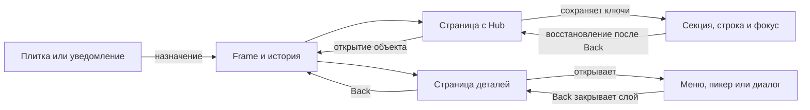

# Сценарии и механики

[Оглавление](../README.md) · [Принципы](foundations.md) · [Компоненты](components.md) · [Источники](sources.md)

Сценарии задают контракты для реализации и ожидаемый результат каждого перехода. В примерах используются вымышленные приложения. Правила истории, жестов и восстановления ниже принадлежат библиотеке. Ссылки показывают платформенные аналоги.

## Кто хранит состояние

| Владелец | Что хранит | Как взаимодействует с другими |
| --- | --- | --- |
| Хост | Возможности оболочки, внешняя активация, настройки среды, доступная геометрия | Передаёт события в приложение и исполняет системные операции через адаптер. |
| Frame | Текущий routeId, параметры, записи истории со своими ключами | Сохраняет состояние уходящей страницы, выполняет Back и активирует новую страницу. |
| Page | Контейнер, инициатор перехода, локальные режимы, черновик и правила ухода | Регистрирует видимые команды и принимает решения о незавершённой работе. |
| Hub / Pivot / TabView | Активная секция или вкладка и связанные локальные состояния | Передаёт на страницу подтверждённый выбор. У независимого документа может быть собственный навигационный контекст. |
| Окно с документными вкладками | Порядок ключей и активную вкладку | Принимает перенос, активирует нужный сеанс и закрывает временное окно после успешного возврата его последней вкладки. |
| Коллекция | Опорный itemId и отступ, выбранные ключи, режим выбора, раскрытые группы | Вычисляет видимые строки по данным. При возврате восстанавливает якорь после загрузки и компоновки. |
| Подборка | Общий набор выбранных ключей и порядок выбора | Синхронизирует выбор между разделами и даёт панели команд один набор целей. |
| Очередь | Позиции со своими ключами, порядок обработки и текущая позиция | Получает записи через явное добавление и передаёт проигрывателю активную позицию. |
| Сеанс переноса | Ключи источника, ожидаемая операция и предварительная позиция вставки | Публикует предпросмотр для цели. Обновление коллекций происходит после подтверждённого результата. |
| Слой | Триггер, область фокуса, правила закрытия, временный выбор | Берёт вход на время показа и возвращает фокус после закрытия. |
| Модель данных | Объекты, результаты запросов, локальные черновики, состояние записи | При повторном входе отдаёт актуальные данные. Страница применяет сохранённое положение поверх них. |
| Синхронизация | Постоянные идентификаторы отправки, подтверждённые версии и результат последней попытки | Обновляет состояние записи в локальном хранилище. Список и редактор показывают результат через общую модель. |

У каждого посещения страницы свой снимок представления, в том числе при повторном посещении того же маршрута. При Back страница восстанавливает позицию и фильтр из посещения, а содержимое актуализирует из модели. Снимок содержит идентификаторы и состав фильтров, а также версию формата. Если часть снимка устарела, восстанавливаются валидные поля, затем выбирается ближайшее осмысленное положение. [Pages and frames в Phone Store apps](https://web.archive.org/web/20140501211142id_/http://msdn.microsoft.com:80/en-us/library/windows/apps/dn596119.aspx)

## Модели структуры Windows Phone

Microsoft описала семь моделей для Phone 8 и 7.1, включая Utility Device и интерфейс игры. Пять моделей в статье Phone 8.1 охватывают обзор с меню, обзор равноправных панелей, Pivot, список с деталями и перелистывание однотипных страниц. Microsoft допускает сочетания. Например, одна секция обзора выводит краткий список, а открытый объект даёт собственный Pivot с вкладками. [App structure and navigation models](https://web.archive.org/web/20121102145906id_/http://msdn.microsoft.com/en-us/library/windowsphone/design/hh202903(v=vs.105).aspx) · [Navigation patterns для Phone 8.1](https://web.archive.org/web/20140523051618id_/http://msdn.microsoft.com:80/en-us/library/windows/apps/dn596118.aspx)

| Модель Microsoft | Из чего складывается сценарий |
| --- | --- |
| Central hub with home-page menu | Домашняя панель даёт явные входы в разделы. Соседние панели дают быстрый доступ к части содержимого этих разделов. Frame открывает раздел или объект по выбранному назначению. |
| Central hub with panel areas | Каждая панель сама представляет область верхнего уровня. Её предметы открывают детали. Пример Microsoft показывает, как у одной строки могут быть разными целями пост и профиль автора, а в профиле открывается свой Pivot. |
| App tabs | Отдельные представления одного контекста, часто различные фильтры. Pivot владеет активным представлением, Frame ведёт историю страниц. Общий App Bar работает, если его команды применимы к каждой вкладке. |
| List with details drilldown | Активация строки открывает выбранный объект. Список остаётся точкой возврата с запомненным положением. Список может быть стартовой страницей или содержимым секции Hub или Pivot. |
| Uniform page shuffle | Страницы одинаково устроены и показывают разные объекты одного вида. В Phone 8.1 для перелистывания предложен Pivot. Настройки набора позволяют добавлять, удалять и переставлять объекты. |
| Utility device | Основной экран организован вокруг конкретной задачи и её непосредственных контролов. |
| Game design | В историческом оглавлении выделены сценарии на основе Silverlight и XNA. |

Для модели самостоятельных панелей Microsoft рекомендует до четырёх областей. При старте эта модель позволяет открыть первую панель или вернуться к последней выбранной. Гайд самого Phone Hub указывает до пяти секций. Для обзора с домашним меню отдельное направление ведёт на страницу задачи. Back из неё возвращает к обзору перед переходом в другую область. [Самостоятельные панели Phone 8.1](https://web.archive.org/web/20140606145944id_/http://msdn.microsoft.com:80/en-us/library/windows/apps/dn596101.aspx) · [Hub с домашним меню Phone 8.1](https://web.archive.org/web/20140606145135id_/http://msdn.microsoft.com:80/en-us/library/windows/apps/dn596100.aspx) · [Phone Hub, стр. 131–135](sources.md#карта-pdf-2014)

Гайд App tabs для Phone 8.1 показывает Pivot с фильтрами одного набора и с разными представлениями общего предмета. Заголовок даёт прямой выбор вкладки. При смене контекста App Bar выводит команды для текущего содержимого. [App tabs в MSDN](https://web.archive.org/web/20140430155135id_/http://msdn.microsoft.com/en-us/library/windows/apps/dn596099.aspx) · [List with details drilldown в MSDN](https://web.archive.org/web/20141006051436id_/http://msdn.microsoft.com:80/en-us/library/windows/apps/dn596115.aspx)

В настольной ветке Windows 8.1 иерархия Hub → раздел → детали подходит для больших коллекций. Плоская модель даёт переключаться между равноправными страницами, вкладками или режимами через содержимое либо верхнюю панель. В длинном обзоре Semantic Zoom даёт дополнительный способ перейти к секции. [Navigation patterns для Windows Store apps](https://web.archive.org/web/20140417010223id_/http://msdn.microsoft.com:80/en-us/library/windowsphone/design/hh761500.aspx)

## 1. От обзора к деталям и обратно

1. Приложение «Каталог» открывается на Hub. Пользователь перетаскивает его с «Новинки» на «Избранное». Страница получает подтверждённый sectionId по завершении приведения к позиции.
2. Нажатие на карточку записывает sectionId, itemId, положение списка и источник фокуса. Frame открывает маршрут карточки. Для просмотра всех избранных выделяется отдельная ссылка секции.
3. Back восстанавливает «Избранное» и актуальные данные. Если объект существует, этот объект снова оказывается в видимой области, фокус возвращается к карточке.
4. Если карточку удалили, выбирается следующий доступный сосед или заголовок секции. Пустая коллекция показывает объяснение и следующее действие.

**Проверка.** Два горизонтальных перелистывания создают одну текущую позицию Hub. Один переход к карточке создаёт запись истории. Один Back возвращает к карточке-источнику. Настройка движения меняет только визуальный переход. [Phone Hub, стр. 131–135](sources.md#карта-pdf-2014) · [Connected animation](https://learn.microsoft.com/en-us/windows/apps/develop/motion/connected-animation)

## 2. Pivot как переключение фильтра

1. На странице «Записи» есть секции «Все», «Новые» и «Отмеченные». Они вычисляются из совместной модели данных, каждая хранит свой якорь прокрутки.
2. Заголовок, свайп и клавиатура ведут к одному событию смены фильтра. Frame остаётся на текущей странице. Посещение деталей записи проходит отдельным переходом.
3. Данные обновляются. Если новых записей сейчас нет, секция показывает текст пустого состояния. Результат обновления сам по себе не двигает пользователя на соседнюю секцию.
4. Возврат из деталей восстанавливает фильтр. Если запись перестала ему соответствовать, представление сохраняет раздел и возвращает фокус к соседу или заголовку.

В образце Microsoft WinJS переход списка в режим множественного выбора устанавливает `Pivot.locked`, а касание строки переключает её выбор. При завершении режима Pivot разблокируется и список снова передаёт активацию записи. Для библиотеки это вариант с выбором в одной секции. [Исходники Phone 8.1](windows-phone-archive.md#разбор-исходников-образцов) · [Подборка из нескольких разделов](#28-выбор-из-нескольких-разделов-и-добавление-в-очередь)

**Проверка.** Back в деталях ведёт к последнему фильтру. На странице Back сначала завершает активный выбор, затем возвращает к предыдущему маршруту. При выборе в одной секции заголовок, жест и клавиатура снова переключают фильтр после выхода из режима. Цикл в Metro-профиле работает в обоих направлениях и не дублирует пункты для средств доступности. [Phone Pivot, стр. 161–164](sources.md#карта-pdf-2014) · [WinUI Pivot](https://learn.microsoft.com/en-us/windows/apps/develop/ui/controls/pivot)

## 3. Back закрывает текущий контекст

Один запрос Back обрабатывается один раз по текущему входному контексту. Ниже порядок диспетчеризации в библиотеке. Для браузера, настольного окна и устройства с системным Back последний шаг определяет адаптер хоста.

При сертификации Windows Phone Microsoft проверяла закрытие диалога, контекстного меню и экранной клавиатуры, возврат со вложенной страницы и выход с главной. Подтверждение выхода допускалось на главной странице. У игр было отдельное правило для паузы во время игры. [Технические требования, раздел 5.2.4](https://web.archive.org/web/20140424024354id_/http://msdn.microsoft.com:80/en-us/library/windowsphone/develop/hh184840(v=vs.105).aspx) · [Разбор проверок Microsoft](https://blogs.windows.com/windowsdeveloper/2014/01/10/top-windows-phone-app-certification-failures-and-how-to-avoid-them/)

В настольном Windows Store 8.1 отдельное руководство описывает экранную кнопку Back для иерархических переходов. При плоской структуре разделы открываются через содержимое или верхнюю панель. В телефоне правила аппаратного Back задаёт оболочка. [Guidelines for back buttons](https://web.archive.org/web/20140413025233/http://msdn.microsoft.com/en-us/library/windowsphone/design/dn439322.aspx)

| Текущее состояние | Результат первого Back | Следующий Back |
| --- | --- | --- |
| Открыт временный слой над страницей | Закрывает верхний слой, если он допускает закрытие. Слой, требующий ответа, удерживает управление до результата. | Обрабатывает новое верхнее состояние. |
| Системная клавиатура активна и платформа отдаёт ей Back | Хост закрывает клавиатуру, поля сохраняют введённое. | Обрабатывает Back приложения. |
| Открыт временный поиск или режим множественного выбора | Временный режим завершается. При переходе к поиску через отдельный маршрут применяется история Frame. | Возвращается по истории. |
| Редактор с несохранённым черновиком | Запускает подтверждение ухода, сохраняя исходный маршрут. | Закрывает подтверждение как отмену, если это предусмотрено диалогом. |
| Находится в деталях, в истории есть предыдущая страница | Возвращает к предыдущей записи. | Обрабатывает состояние предыдущей страницы. |
| История приложения пуста | Передаёт управление политике хоста. Например, оболочка устройства возвращает на предыдущую системную поверхность. | Определяется хостом. |

**Проверка.** На странице с черновиком и раскрытым picker первый Back закрывает picker. Второй запрашивает решение по черновику. Если при завершении перехода исходный контрол уже демонтирован, фокус переходит к устойчивому элементу текущей страницы. [Back button, гайд Phone 7, стр. 110](https://tableless.github.io/exemplos/pdf/guidelines-interface-mobiles/UI%20Design%20and%20Interaction%20Guide%20for%20Windows%20Phone%207%20v2.0.pdf#page=56) · [Navigation history and Back](https://learn.microsoft.com/en-us/windows/apps/design/basics/navigation-history-and-backwards-navigation)

## 4. Пункт верхнего уровня и позиция внутри документа

1. В широком окне «Проекты» открываются через боковой NavigationView. В узком — через адаптивную панель. Смена ширины сохраняет выбранный пункт, страницу и параметры.
2. Приложение задаёт для пунктов верхнего уровня политику истории. Для равноправных пунктов может применяться замена текущего раздела. При переходе в деталь применяется запись в истории.
3. BreadcrumbBar «Проекты / Север / Задачи» разрешает переход к указанному предку. История обновляется согласно политике конкретного приложения. Выбранная навигация и заголовок вычисляются из активного маршрута.
4. При независимых вкладках TabView переключение сохраняет состояние каждой. Закрытие документа проверяет его черновик, закрытие соседней вкладки сохраняет текущий контекст.

**Проверка.** Deep link в задачу подсвечивает «Проекты». После Back активный пункт соответствует маршруту. Переход по хлебной крошке работает даже при короткой истории посещений. [Navigation basics](https://learn.microsoft.com/en-us/windows/apps/design/basics/navigation-basics) · [NavigationView, BreadcrumbBar и TabView](sources.md#прямые-ссылки-на-каталог-контролов-winui)

## 5. Переполнение, контекстная команда и подтверждение

1. «Добавить» постоянно видно на странице. «Экспорт» доступен в многоточии. Для строки «Запись 34» контекстное меню предлагает «Переименовать» и «Удалить».
2. Многоточие открывает overflow. В Phone-профиле открытие также показывает подписи иконок. Back и повторное нажатие многоточия закрывают слой. Клавиатура возвращается на триггер.
3. «Удалить» запоминает идентификатор записи, закрывает меню и открывает диалог. Отмена сохраняет фокус и запись. При подтверждении кнопка показывает выполнение и защищает от повторного запроса.
4. При успехе фокус перемещается к соседней видимой строке. При ошибке сохраняется запись и показывается результат там, где пользователь может повторить действие.

**Проверка.** Контекст из правого клика, удержания и клавиатуры разрешает одну и ту же целевую запись. Если запись исчезла пока меню открыто, подтверждение приводит к безопасному завершению с понятным статусом. [Phone Application Bar, стр. 30–37](https://tableless.github.io/exemplos/pdf/guidelines-interface-mobiles/UI%20Design%20and%20Interaction%20Guide%20for%20Windows%20Phone%207%20v2.0.pdf#page=16) · [CommandBar и Dialogs](sources.md#прямые-ссылки-на-каталог-контролов-winui)

## 6. Длинный список, обзор групп и выбор

1. В списке «Авторы» заголовок группы открывает обзор букв. Desktop-профиль может добавить вход через Semantic Zoom.
2. В обзоре выбор буквы возвращает подробный список к первому доступному элементу группы. Отмена возвращает предыдущий якорь. После локализации буквы берутся из реально сгруппированных данных и сортируются по правилам языка.
3. В списке действие «Выбрать» вводит режим с галочками. Тап по строке переключает её selectedId. Панель показывает количество и команды для набора.
4. Back из режима выбора возвращает обычную активацию. Изменение фильтра следует явно заданной политике. Если скрытые записи сохраняются в выборке, счётчик и контекст операции включают их видимым для пользователя образом.

**Проверка.** Виртуализация не меняет выбранные ключи при прокрутке. Удалённый идентификатор исчезает из выбора. Групповая команда разрешает весь актуальный набор выбранных ключей, включая строки за пределами области прокрутки. [LongListSelector SDK](https://learn.microsoft.com/en-us/previous-versions/windows/apps/jj208486(v=vs.105)) · [Semantic Zoom](https://learn.microsoft.com/en-us/windows/apps/develop/ui/controls/semantic-zoom) · [ListView и GridView](https://learn.microsoft.com/en-us/windows/apps/develop/ui/controls/listview-and-gridview)

## 7. Список и детали на узком и широком экране

1. На узком экране выбор проекта открывает детали на весь доступный экран. Список запоминает якорь и активированную строку.
2. При увеличении ширины детали становятся соседней панелью. Исходный selectedId и состояние редактора сохраняются. Frame адаптирует представление текущего назначения без дополнительного пользовательского перехода.
3. При выборе другого проекта из широкой панели детали меняются, а правило несохранённого черновика применяется до смены.
4. При сужении открытые детали снова занимают экран. Back показывает список в прежнем контексте. В широком виде политика Back может снять выбор либо вернуть к предыдущему месту, в зависимости от сделанной записи истории.

**Проверка.** После нескольких изменений ширины объект, статус ошибки и введённый текст остаются теми же. Смена ширины сохраняет размер журнала переходов. [List/details](https://learn.microsoft.com/en-us/windows/apps/develop/ui/controls/list-details) · [TwoPaneView](https://learn.microsoft.com/en-us/windows/apps/develop/ui/controls/two-pane-view)

## 8. Поиск и подсказки

В руководстве Phone 8.1 аппаратная клавиша Search принадлежит системному поиску. Внутренний поиск приложение открывает через собственное поле или команду. [First look at Windows Phone](https://web.archive.org/web/20140531182055id_/http://msdn.microsoft.com:80/en-us/library/windowsphone/design/dn596110.aspx)

1. Видимая команда открывает поле или маршрут поиска. Фокус переходит в поле. IME завершает композицию до отправки запроса.
2. Подсказки используют текущий текст. Каждый ответ связывается с его запросом, запоздалый ответ не заменяет актуальные подсказки. Выбор предложения или Enter осуществляет заявленное действие: заполняет запрос либо открывает конкретный результат.
3. Состояния списка результатов различают пустой ввод, загрузку, отсутствие совпадений, результат и сбой. Поиск по странице работает с текущим экраном и может показывать номер совпадения.
4. Back закрывает открытые подсказки, затем возвращает по правилам временного слоя или маршрута. Возврат из результата сохраняет запрос и позицию.

**Проверка.** С последовательностью запросов «а», «ав», «авт» пользователю доступны результаты последнего запроса. При вводе клавиатурой стрелки выбирают предложение, доступное имя поля сохраняется. [Поиск в гайде 2014, стр. 184 и 302](sources.md#карта-pdf-2014) · [AutoSuggestBox](https://learn.microsoft.com/en-us/windows/apps/develop/ui/controls/auto-suggest-box)

## 9. Форма, пикер и незавершённый черновик

1. Открытие редактора загружает исходные данные отдельно от черновика. Изменённое значение делает форму dirty. Ошибка поля связана с подписью, значением и местом исправления.
2. Выбор даты открывает пикер с временным значением. Принять сохраняет его в черновик страницы, отмена восстанавливает прежнее. Внешняя клавиатура и касание могут выполнить тот же выбор.
3. Сохранение валидирует черновик, блокирует повторный запуск, показывает прогресс соответствующего масштаба. При сбое введённые значения остаются доступны.
4. Уход с изменениями открывает диалог с явными вариантами остаться, отбросить изменения или сохранить, если доступно. При успешном сохранении исходный запрошенный переход продолжается один раз.

**Проверка.** Отмена пикера не делает форму dirty. Escape в пикере закрывает пикер, Back с изменённой формой открывает подтверждение. Результат одного сохранения не обрабатывается дважды. [Формы, диалоги и пикеры WinUI](sources.md#прямые-ссылки-на-каталог-контролов-winui) · [Guidelines for form layouts, стр. 314](sources.md#карта-pdf-2014)

## 10. Свайп, прокрутка и конфликт осей

1. Указатель нажимает строку в Pivot. Строка показывает press, а решение об активации ожидает отпускания.
2. После преодоления порога движения владение принимает один участник. Вертикальное движение обрабатывает список. Горизонтальное принадлежит Pivot, если область явно не делегирована вложенному контролу. Системный жест края участвует с приоритетом хоста.
3. Если карточкам нужны собственные горизонтальные свайпы, они получают отдельный экран или предусмотренную зону захвата. У каждого жеста есть доступная команда через меню или кнопку. Удержание отменяется при начале drag.
4. При отпускании владелец завершает движение или возвращает прежнюю позицию. При `pointercancel`, потере захвата или смене ориентации очищается press, отпускается захват и сохраняется последнее подтверждённое состояние.

**Проверка.** Диагональное движение вокруг порога не перескакивает между владельцами. Завершённый свайп не вызывает клик по строке. Повторный tap после освобождения захвата работает. [Phone Pivot и Phone Hub](sources.md#карта-pdf-2014) · [Touch interactions](https://learn.microsoft.com/en-us/windows/apps/design/input/touch-interactions) · [SwipeControl](https://learn.microsoft.com/en-us/windows/apps/develop/ui/controls/swipe)

## 11. Обновление, пустой экран и ошибка

1. На первом входе без данных отображается загрузка внутри области. С доступными данными при обновлении показ остаётся интерактивным. Индикатор исчезает после завершения, отмены или ошибки.
2. Обновление может запустить жест, кнопка панели или восстановление подключения. Одновременно используется один актуальный запрос для данной области либо результат каждого запроса проверяется по поколению.
3. При успехе сохраняется якорь, новые записи получают видимые позиции, а завершение коротко объявляется. У пустой коллекции есть собственное объяснение. Сбой со старыми данными показывает inline-статус и повтор. Сбой без данных даёт состояние ошибки на месте коллекции.

**Проверка.** Ошибка обновления оставляет старые записи интерактивными. Отмена не показывает ошибку как результат. Повтор позволяет получить данные и возвращает индикацию в норму. [Phone Hub и progress controls](sources.md#карта-pdf-2014) · [Pull-to-refresh](https://learn.microsoft.com/en-us/windows/apps/develop/ui/controls/pull-to-refresh) · [InfoBar](https://learn.microsoft.com/en-us/windows/apps/develop/ui/controls/infobar)

## 12. Закрепление, обновление плитки и активация

1. Из карточки «Маршрут до парка» пользователь вызывает «Закрепить». Хост подтверждает системное закрепление там, где оно поддерживается. После отмены UI остаётся в прежнем состоянии.
2. Плитка связывает идентификатор с маршрутом и параметрами. Малый размер показывает основное обозначение, больший добавляет сведения. Фоновая публикация обновляет содержимое и срок актуальности.
3. По нажатию на плитку хост передаёт параметры маршрутизатору. Он разрешает их на холодном старте и при активном приложении. Отсутствующий объект открывает состояние недоступности с выходом в соответствующий раздел.
4. Необходимый вход в аккаунт приводит через промежуточный маршрут. После завершения входа возобновляется исходное назначение. Back из холодно открытой детали следует политике хоста или явно построенной родительской истории.

**Проверка.** Два разных объекта дают разные назначения. Снятие закрепления удаляет запись оболочки и сохраняет сам объект. Текст и счётчик не раскрывают скрытые данные после смены аккаунта. [Phone 8 Start](https://blogs.windows.com/windowsexperience/2012/11/02/the-story-behind-the-windows-phone-8-start-screen/) · [Secondary tiles design guidance](https://learn.microsoft.com/en-us/windows/uwp/launch-resume/secondary-tiles-guidance)

В Phone 8 создание вторичной плитки переводило пользователя на Start. Back возвращал в приложение. Видимая команда могла переключаться с закрепления на снятие закрепления по состоянию выбранного объекта. В библиотеке переход в оболочку и подтверждение размещения обрабатывает адаптер конкретного хоста. [Tile design guidelines for Windows Phone](https://learn.microsoft.com/en-us/previous-versions/windows/apps/jj662929(v=vs.105))

## 13. Toast, центр уведомлений и повторный вход

В Phone Store apps плитка, toast и raw-уведомление обслуживают разные ситуации. В этом сценарии уведомление о новом событии появляется на плитке, если достаточно сообщить о нём, или в toast, если для человека уместно действие сейчас. Данные raw-уведомления обрабатываются в приложении и могут изменить его состояние. [Essential graphics, visual indicators, and notifications](https://web.archive.org/web/20141012014027id_/http://msdn.microsoft.com:80/en-us/library/windows/apps/dn596109.aspx)

1. Новое событие обновляет модель. Приложение передаёт хосту краткий текст и назначение для toast либо обновляет счётчик соответствующей области.
2. Истечение toast оставляет приложение на текущем маршруте. Активация из toast или истории уведомлений передаёт один тип назначения, который может разрешиться при открытом или закрытом процессе.
3. Объект уже прочитан или удалён. При повторной активации приложение показывает актуальное состояние и понятный путь в связанный раздел. Уведомление и счётчик обновляются по событиям модели.

**Проверка.** Активация одного уведомления дважды не создаёт дублирующий экран, если назначение уже открыто. Счётчик отражает данные, а действия доступны и после исчезновения краткой поверхности. [Phone 8.1 Action Center](https://blogs.windows.com/windowsexperience/2014/04/02/cortana-yes-and-many-many-other-great-features-coming-in-windows-phone-8-1/) · [Плитки и уведомления, стр. 355–388](sources.md#карта-pdf-2014)

## 14. Системный выбор, Share и граница приложения

1. Команда «Вложить файл» открывает системный picker. Страница сохраняет черновик и связывает внешний запрос со своим контекстом.
2. Отмена оставляет черновик. После результата проверяются способность открыть файл и существование исходной страницы. Если контекст восстановлен, файл добавляется один раз.
3. Команда «Поделиться» передаёт системной поверхности данные, которые выбрал пользователь. При приёме данных приложение сначала показывает доступное действие и назначение импорта.
4. При временной потере фокуса страница сохраняет положение. Если системная интеграция отсутствует, интерфейс использует доступный путь для той же операции, когда он есть.

Образец Phone 8.1 отправляет запрос через `PickSingleFileAndContinue`. При следующей активации приложение подготавливает Frame и восстанавливает состояние, если процесс был завершён. Затем `ContinuationManager` передаёт событие текущей странице. Страница отображает имя выбранного файла или сообщение об отмене. В библиотеке запрос дополнительно хранит ключ черновика, чтобы восстановленная форма могла проверить принадлежность результата. [Исходники File picker sample](windows-phone-archive.md#разбор-исходников-образцов)

Для открытия файла во внешнем приложении руководство Windows Store описывает делегирование системе. Если нужен выбор обработчика, оболочка показывает Open With рядом с инициатором. Приложение передаёт файл или URI и точку вызова. [Guidelines for file types and URIs](https://web.archive.org/web/20140502075523/http://msdn.microsoft.com/en-us/library/windowsphone/design/hh700321.aspx)

**Проверка.** Закрытие системного окна не дублирует инструмент, ошибку можно устранить без потери работы, результат позднего picker не обновляет другой объект. [Контракты, Share и File pickers, стр. 25–85](sources.md#карта-pdf-2014) · [Сравнение Windows 8 и Phone 8](sources.md#windows-phone-8-и-windows-8)

## 15. Приостановка, восстановление и смена среды

1. После переключения из приложения хост даёт шанс сохранить состояние. Frame фиксирует минимальный снимок маршрута, текущей секции, якоря, фильтра и черновика, если тот предназначен для восстановления.
2. При возвращении тёплый процесс сначала пользуется текущей моделью и сверяет данные. При холодном восстановлении он загружает снимок, проверяет маршрут и параметры, восстанавливает данные и компоновку, затем позицию и фокус.
3. Явная внешняя активация разрешается независимо от сохранённого маршрута. Если пользователь был в редакторе, хост применяет объявленную политику черновика до смены назначения.
4. При появлении внешнего экрана или изменении размеров строится соответствующий макет. Возможность независимых представлений и ввода определяется хостом, как для исторического Continuum.

**Проверка.** Снимок с пропавшей записью ведёт к ближайшему существующему контексту. Повторное восстановление не повторяет запись данных. После изменения размера или темы незавершённая задача остаётся доступна. [Tombstoning and the Zen of Async](https://learn.microsoft.com/en-us/archive/msdn-magazine/2012/october/windows-phone-tombstoning-and-the-zen-of-async-for-windows-phone) · [Continuum for phones](https://learn.microsoft.com/en-us/windows-hardware/design/device-experiences/continuum-phone)

## 16. Настройки темы и поведения

1. Раздел «Оформление» открывается обычным маршрутом. Переключатель включает мгновенно действующее правило, а radio-группа задаёт режим «Системная», «Светлая» или «Тёмная».
2. При выборе приложение обновляет общий набор токенов. Выбранные строки, текущая секция и открытый диалог сохраняют идентичность. Новый цвет фокуса остаётся видимым на текущей поверхности.
3. В режиме «Системная» изменение темы или акцента приходит от хоста. Локально выбранная тема остаётся явным значением пользователя. При ошибке сохранения отображается фактическое состояние и доступ к повторной попытке.
4. При включении системной контрастной темы активные состояния получают контрастные кисти. Открытый диалог, выделение списка и фокус сохраняются. После выхода из контрастной темы действует ранее выбранный режим.

**Проверка.** Смена системной темы во время редактирования меняет оформление поля, сохраняя курсор и черновик. При открытом диалоге контур фокуса видим в контрастной теме. Повторный вход в настройки показывает ранее записанный режим. [Theme resources for Windows Phone](https://learn.microsoft.com/en-us/previous-versions/windows/apps/ff769552(v=vs.105)) · [ThemeResource в WinUI](https://learn.microsoft.com/en-us/windows/apps/develop/platform/xaml/themeresource-markup-extension) · [ToggleSwitch](https://learn.microsoft.com/en-us/windows/apps/develop/ui/controls/toggles)

## 17. Просмотр медиа, полноэкранный режим и зум

1. Из сетки «Альбомы» открывается объект с первоначальным itemId. FlipView использует соседей в том же порядке, пока просмотр сохраняет этот контекст коллекции.
2. При обычном масштабе жест перелистывает фото. В увеличенном изображении pan управляет его положением, pinch меняет масштаб. Для перехода к соседнему объекту доступны явные кнопки или клавиши. Если элемент исчез, просмотр показывает ближайший доступный объект или возвращает к коллекции.
3. Полноэкранный режим меняет видимость панелей, сохраняя доступный способ вернуть управление. Хост продолжает показывать системные уведомления по своим правилам. Back сначала закрывает временный режим, затем возвращает к исходному списку. Индикатор буфера и позиция воспроизведения хранят разные состояния.

**Проверка.** Pan увеличенного изображения оставляет тот же itemId. Поворот или resize сохраняет открытый объект. После возврата из полноэкранного просмотра фокус доступен на панели или в исходной коллекции. [Полноэкранный режим и ориентация Phone 8.1](https://web.archive.org/web/20140501211142id_/http://msdn.microsoft.com:80/en-us/library/windows/apps/dn596119.aspx) · [FlipView, ScrollView и Media playback](sources.md#прямые-ссылки-на-каталог-контролов-winui)

## 18. Перелистывание однотипных страниц

1. В приложении прогноза каждая страница использует одну компоновку для отдельного города. Города имеют стабильные ключи и пользовательский порядок. Переключение свайпом, кнопками или клавишами меняет текущий ключ внутри набора.
2. App Bar открывает управление набором. «Добавить город» ведёт к поиску, после выбора город входит в набор. Там же доступны изменение порядка и удаление. При перестановке активный ключ сохраняется, при удалении открывается следующий доступный город или пустое состояние.
3. Back уходит из управления набором к просмотру. Перелистывание само по себе не создаёт новую запись маршрута для каждого города. При возврате из прогноза на отдельный день восстанавливаются ключ города и контекст прокрутки.

**Проверка.** Перестановка городов сохраняет текущий город. После удаления текущего города открывается ожидаемый сосед, а для пустого набора доступна команда добавления. Свайп и доступные кнопки выбирают элементы в одном порядке. [Uniform page shuffle для Phone 8.1](https://web.archive.org/web/20140618190016id_/http://msdn.microsoft.com:80/en-us/library/windowsphone/design/dn596124.aspx) · [Просмотр элементов внутри страницы Phone 8.1](https://web.archive.org/web/20140501211142id_/http://msdn.microsoft.com:80/en-us/library/windows/apps/dn596119.aspx) · [FlipView](https://learn.microsoft.com/en-us/windows/apps/develop/ui/controls/flipview)

## 19. Камера, подтверждение и повторное открытие снимка

Phone 8 Lens открывал видоискатель из системной камеры. Microsoft описала прямое сохранение и захват с подтверждением. Позднее системный просмотрщик мог открыть созданный снимок в приложении, если у снимка был связанный режим просмотра или редактирования. В библиотеке это сценарий для хоста, который поддерживает внешнюю активацию и передачу снимка. [Lens design guidelines for Windows Phone](https://web.archive.org/web/20121103005627/http://msdn.microsoft.com/en-us/library/windowsphone/design/jj662922(v=vs.105).aspx)

1. Хост передаёт контекст запуска. Frame открывает видоискатель, где доступны захват и выход. Пересчёт геометрии после поворота сохраняет явно выбранные режимы камеры.
2. При прямом захвате результат сохраняется через хост, а видоискатель принимает следующий ввод после подтверждения сохранения. В режиме с проверкой создаётся временный снимок. «Сохранить» записывает его, «Отменить» освобождает временные данные. Оба результата возвращают к видоискателю.
3. При запуске из просмотра фотографии Frame открывает связанный объект по идентификатору. Действие «Сохранить копию» становится доступным после правки. Оно оставляет пользователя на экране редактирования с подтверждённым результатом. Back возвращает к выбранной фотографии в системном просмотрщике через хост.
4. Если дополнительная информация о снимке недоступна, страница показывает доступное стандартное изображение или сообщает, что объект уже недоступен. Повторное сохранение должно быть отдельной подтверждённой операцией.

**Проверка.** Отмена на экране предпросмотра оставляет число сохранённых снимков прежним. При запуске из просмотра детали открываются для выбранного снимка. После сохранения копии результат виден на текущем экране. Потеря связанных данных даёт выход или просмотр доступного изображения. [Рекомендации Lens для Phone Store apps](https://web.archive.org/web/20140408235720id_/http://msdn.microsoft.com:80/en-us/library/windowsphone/design/dn596114.aspx) · [Lens в сводном PDF, стр. 33](https://tilsgee.github.io/DesignGuidelinesArchive/uwp8.1.pdf#page=33)

## 20. Адаптивная панель команд

1. В широком списке документов панель показывает «Создать», «Сортировать» и «Фильтр». Дополнительные действия доступны через многоточие. У «Фильтра» есть видимое состояние переключателя.
2. При сужении панели «Фильтр» переносится в меню. Его текущее состояние и клавиатурное действие остаются доступны. После увеличения ширины команда снова появляется на панели, если помещается.
3. Выбор строк подставляет команды для выбранных документов. Перенос этих команд меняет видимое место, сохраняя идентификаторы целей. При исчезновении всего выбранного набора открытое контекстное меню закрывается и фокус возвращается в список.
4. Открытая команда проверяет доступность цели перед выполнением. Изменение ширины во время выполнения сохраняет состояние операции и её итог в одном месте.

**Проверка.** До и после переноса «Фильтр» открывает одну и ту же настройку, а её включённость совпадает на панели и в меню. Фокус остаётся в доступной части поверхности. При изменении выбора во время открытого меню снятые с выбора документы не обрабатываются случайно. [CommandBar](https://learn.microsoft.com/en-us/windows/apps/develop/ui/controls/command-bar) · [Коллекции и прямое управление](components.md#коллекции-и-прямое-управление)

## 21. Экран блокировки и основная плитка

1. Пользователь выбирает в настройках оболочки приложение для статуса и, при необходимости, отдельного поставщика фона. Хост сообщает, какие роли доступны и включены.
2. Событие обновляет основную плитку и связанные представления. Для быстрого статуса хост получает значок и доступное значение счётчика. Для подробного статуса используется краткий текст. В историческом адаптере Phone 8 текст для Flip берётся из широкой или средней плитки по правилам платформы.
3. При сбое получения фона хост использует стандартное изображение. Отключение статуса прекращает его публикацию на экране блокировки. Плитка Start продолжает работать по собственным настройкам.
4. После открытия приложения и просмотра событий модель пересчитывает счётчик. Адаптеры получают то же значение при следующей публикации.

**Проверка.** Отключение статуса экрана блокировки убирает его в этой поверхности. Установка нулевого счётчика убирает число. При отсутствии данных широкой Flip-плитки исторический профиль использует текст средней. [Руководство по экрану блокировки Phone 8](https://learn.microsoft.com/en-us/previous-versions/windows/apps/jj662927(v=vs.105)) · [Руководство для Phone Store apps](https://web.archive.org/web/20140408235720id_/http://msdn.microsoft.com:80/en-us/library/windowsphone/design/dn596116.aspx)

## 22. Общая коллекция с разной навигацией на телефоне и ПК

В 2015 году команда Windows описала проектный вариант Photos, где на телефоне между коллекцией и альбомами можно перелистывать Pivot одной рукой, а на ПК те же области открываются через меню. Это пример выбора представления в период разработки Windows 10. [Windows 10 Design](https://blogs.windows.com/windowsexperience/2015/04/29/windows-10-design-getting-the-balance-right/)

1. Два места назначения «Коллекция» и «Альбомы» имеют постоянные ключи. Узкий профиль с касанием отображает их в Pivot, настольный — в NavigationView. Оба способа выбирают одну модель активного раздела.
2. Переход к отдельному фото создаёт историю. При смене устройства ввода или окна в уже открытом фото выбранный раздел и фото сохраняются. Оболочка подстраивает представление под доступное место.
3. При возврате из фото Frame восстанавливает исходный раздел и якорь коллекции. Состояние фокуса переводится на видимый элемент текущего макета, если прежний узел больше недоступен.
4. Программное отражение выбора в NavigationView при восстановлении обновляет выделенный пункт. Запрос перехода обрабатывается только один раз.

**Проверка.** Свайп Pivot и выбор пункта NavigationView открывают один раздел данных и сохраняют одинаковую историю просмотра. Back из фото возвращает к заданной записи во всех профилях. [NavigationView](https://learn.microsoft.com/en-us/windows/apps/develop/ui/controls/navigationview) · [List/details](https://learn.microsoft.com/en-us/windows/apps/develop/ui/controls/list-details)

## 23. Речь как способ вызвать команду

В Phone 8.1 системная голосовая команда могла запускать конкретную задачу. Для распознавания внутри приложения гайд предлагает явную кнопку микрофона в App Bar и пример фразы для текущего экрана. При низкой уверенности он предлагает запросить подтверждение, а после нескольких неудачных попыток дать ввести текст или закрыть распознавание. Для короткого списка допустимых фраз Phone 8.1 поддерживал локальное распознавание. Встроенная диктовка требовала сеть. [Speech design guidelines](https://web.archive.org/web/20141022104513id_/http://msdn.microsoft.com/en-us/library/windows/apps/dn596121.aspx) · [Cortana integration и образцы распознавания](https://blogs.windows.com/windowsdeveloper/2014/09/23/cortana-integration-and-speech-recognition-new-code-samples/)

1. Кнопка микрофона запускает распознавание через хост. Состояния «слушаю», «обрабатываю» и «остановлено» отображаются текстом и доступны для озвучивания. Отмена возвращает фокус к кнопке.
2. Распознанная фраза разрешается в команду и параметры. Неоднозначный результат открывает список совпадений с доступным выбором. Ошибка оставляет путь повторить попытку или выполнить действие через экран.
3. Системная активация передаёт то же назначение через адаптер. Frame открывает нужное место. Если действие требует подтверждения, запуск подготавливает действие и показывает его итоговое назначение.
4. После отмены распознавания поздний результат поглощается по идентификатору запроса. Новый запуск получает новый идентификатор и наследует только устойчивый контекст страницы.

**Проверка.** Речь и видимая команда открывают одно назначение. Неоднозначный результат сохраняет исходный экран до выбора. Отмена очищает индикатор и защищает от позднего открытия другого маршрута. [Системные контракты Windows Phone 8.1](sources.md#windows-81-и-windows-phone-81)

## 24. Hub с разнородными данными и частичной загрузкой

1. На широком экране Hub каталога показывает приоритетное содержимое, затем подборки, недавние записи и отдельную секцию справки. У каждой секции свой источник данных и ключ. Для первого показа подготавливаются видимые секции. Остальные загружаются без блокировки уже видимого содержимого.
2. Заголовок подборки с действием открывает весь список подборки. Вход через карточку открывает конкретный объект. Клавиатурный переход на заголовок соседней секции приводит её в видимую область без записи Frame.
3. Если загрузка одной секции завершается ошибкой, она показывает повтор. Другие секции и их команды остаются доступны. Поздний результат удалённой секции проверяет ключ и версию запроса перед обновлением.
4. В узком настольном окне Hub располагает те же секции вертикально. После возврата из деталей восстанавливается выбранная секция и опорный элемент. При смене оси прежнее смещение используется только в совместимой геометрии.
5. Обзор секций по Semantic Zoom приводит к выбранной секции по тому же ключу. Back из страницы со всем содержимым раздела восстанавливает исходный Hub.

**Проверка.** Видимая часть доступна при незавершённой фоновой загрузке. Ошибка справки не блокирует открытие карточки. Повторный вход после изменения ширины возвращает к осмысленному элементу. Выбор секции в обзоре меняет позицию Hub, а открытие подробной страницы добавляет запись Frame. [Hub для разнородных данных](https://blogs.windows.com/windowsdeveloper/2014/02/05/introducing-the-new-hub-control-for-heterogeneous-data/) · [Semantic Zoom в WinUI](https://learn.microsoft.com/en-us/windows/apps/develop/ui/controls/semantic-zoom)

## 25. Phone Hub и команды текущей секции

1. У Hub три секции, «Обзор», «Недавние» и «Избранное». В начальной секции панель минимальная. Глобальные команды приложения доступны через меню.
2. Пользователь перелистывает до «Недавних». Когда эта секция становится первой видимой, панель показывает основную команду «Очистить недавние» в компактном режиме. Край следующей секции на экране сохраняет подсказку о возможности перелистывания.
3. Пользователь перелистывает дальше. Панель скрывает команду секции и возвращается в минимальный режим. Если меню уже открыто и контекст изменился, библиотека закрывает его и возвращает фокус в текущую секцию.
4. Карточка из «Недавних» открывает детали. Back восстанавливает секцию, опорную строку и панель с командами этой секции. Вызов команды передаёт идентификатор секции, а подтверждение проверяет актуальность контекста перед применением.

**Проверка.** Частично видимая секция не перехватывает панель у первой видимой. Перелистывание не добавляет запись Frame. После возврата доступны те же команды. В варианте с двумя секциями перелистывание останавливается на границах. [Phone Hub и AppBar в образце Microsoft](https://blogs.windows.com/windowsdeveloper/2014/07/22/tips-and-tricks-for-using-xaml-controls-in-your-universal-windows-apps/) · [Порядок обработки Back](#3-back-закрывает-текущий-контекст)

## 26. Карта из обзора и возврат к выбранному месту

1. Секция «Рядом» в Hub показывает статическое превью карты и список мест. Перелистывание над превью остаётся жестом Hub. Нажатие «Открыть карту» создаёт запись Frame с областью поиска, ключом секции и точкой возврата фокуса.
2. Карта занимает основную область страницы. Касание и клавиатура позволяют перемещаться по карте, менять масштаб и открывать доступный список точек. Сохранённая область и текущий выбор работают без геолокации. Если пользователь запрашивает своё местоположение, карта использует результат, предоставленный хостом.
3. Выбор метки обновляет встроенное описание в панели карты без записи в истории. Команда из описания открывает страницу места. Frame запоминает выбранную точку, границы видимой области и масштаб, а карта обновляет данные независимо от положения.
4. Back из карточки восстанавливает карту с прежней областью и возвращает фокус в краткое описание. Если точка исчезла, карта сохраняет область и переводит фокус на список мест. Следующий Back возвращает к кнопке, с которой открыли карту в Hub.

**Проверка.** Свайп по превью перелистывает Hub. После открытия карты тот же жест панорамирует карту. Два нажатия Back возвращают сначала на карту, а затем к прежней секции обзора. Отказ в геолокации оставляет доступными ручное перемещение и точки из текущей области. [Phone Hub](https://web.archive.org/web/20140408233046id_/http://msdn.microsoft.com/en-us/library/windowsphone/design/dn596112.aspx) · [Guidelines for Maps](https://web.archive.org/web/20140408235720id_/http://msdn.microsoft.com:80/en-us/library/windowsphone/design/dn596102.aspx)

## 27. Запуск из оболочки и общий проигрыватель

В шаблоне информационной архитектуры Microsoft перечислены три системные точки входа в музыкальное приложение. Внутри есть ветка входа и регистрации, Panorama, поиск, библиотека, недавние записи, контекстные действия и несколько путей к проигрывателю. [IA Sample, архивный PDF](https://web.archive.org/web/20121118220154id_/http://cmsresources.windowsphone.com/devcenter/en-us/downloads/IA_sample.pdf)

1. Адаптер хоста принимает запуск из списка приложений, плитки или музыкальной поверхности. Frame разрешает назначение. Если для него нужен вход в аккаунт, приложение хранит незавершённое назначение и открывает форму входа.
2. Ошибка входа оставляет форму и назначение доступными для повтора. Успешный вход применяет назначение один раз. Явная отмена удаляет отложенный переход. После запуска общий обзор становится точкой входа в библиотеку, недавние записи и поиск.
3. Активация записи открывает проигрыватель с ключом записи и контекстом очереди. Проигрыватель владеет позицией и воспроизведением. Экран, с которого открыли запись, хранит свою позицию и фильтр. Меню текущей записи получает тот же ключ, поэтому его команды относятся к отображаемой записи.
4. Back закрывает открытое меню проигрывателя, затем восстанавливает список или поиск с прежним фильтром. Состояние воспроизведения сохраняется по правилам хоста. Повторное открытие текущей записи подхватывает её сохранённую позицию.

**Проверка.** Из поиска и недавних записей можно открыть один и тот же объект. После закрытия проигрывателя каждая точка входа восстанавливает своё положение. Успешный вход после ошибки применяет отложенный переход один раз. Отмена входа очищает назначение. [Шаблон структуры приложения](https://web.archive.org/web/20121118220154id_/http://cmsresources.windowsphone.com/devcenter/en-us/downloads/IA_sample.pdf) · [Системная активация и возврат](#12-закрепление-обновление-плитки-и-активация)

## 28. Выбор из нескольких разделов и добавление в очередь

1. В коллекции «Аудиозаписи» tap открывает запись. В профиле Windows Store короткий cross-slide поперёк прокрутки отмечает запись. Команда «Выбрать» даёт тот же результат без жеста.
2. Пользователь переходит в другую группу и отмечает ещё одну запись. Подборка показывает обе записи с доступными названиями. Счётчик и панель команд опираются на те же ключи, поэтому прокрутка или фильтр не меняют состав выбора.
3. Команда «Добавить в очередь» разрешает ключи и создаёт позиции очереди в видимом порядке подборки. Порядком воспроизведения после добавления владеет очередь. Ещё одно явное добавление той же записи создаёт отдельную позицию.
4. Back из открытой подборки закрывает её представление и возвращает фокус к вызвавшей кнопке. Когда запись исчезает из каталога, подборка обновляет счётчик. Если это случилось при добавлении, результат команды сообщает, какая запись пропущена.

**Проверка.** Короткое касание открывает запись, cross-slide отмечает её. Переключение группы сохраняет счётчик и выбранные ключи. Повторное добавление создаёт отдельную позицию очереди, а в подборке запись остаётся единственной. [Guidelines for cross-slide](https://learn.microsoft.com/en-us/windows/apps/develop/input/guidelines-for-cross-slide) · [Проигрыватель и контекст очереди](#27-запуск-из-оболочки-и-общий-проигрыватель)

## 29. Перетаскивание и изменение порядка

1. Пользователь выбирает записи и за ручку начинает перенос. Источник фиксирует ключи и исходную версию списка. До захвата движения прокрутка и активация строк обрабатываются обычным способом.
2. При наведении между элементами цель показывает место вставки и доступную операцию. Предпросмотр может сдвинуть соседние строки. В модели порядок сохраняется до подтверждения.
3. При отпускании команда проверяет, что записи, цель и границы группы ещё существуют. После успеха фокус следует за перемещённым элементом. При ошибке или отмене предпросмотр исчезает, а список возвращается к подтверждённому порядку.
4. Для переноса между списками целевая коллекция подтверждает вставку. После подтверждения Move источник удаляет перемещённые позиции. Copy оставляет обе версии доступными. Клавиатурные команды движения внутри списка и команда переноса в другой список используют те же ключи и проверки.

**Проверка.** Отмена над недопустимой целью и удаление цели во время жеста не меняют порядок. Перенос с клавиатуры даёт тот же результат, что и перенос указателем. Источник исчезает только после успешного Move. Считыватель сообщает выбранную операцию и итоговое положение. [Drag and drop](https://learn.microsoft.com/en-us/windows/apps/develop/data/drag-and-drop) · [ListViewBase.CanReorderItems](https://learn.microsoft.com/en-us/windows/windows-app-sdk/api/winrt/microsoft.ui.xaml.controls.listviewbase.canreorderitems?view=windows-app-sdk-1.8)

## 30. Обновление коллекции с сохранением фокуса

1. На странице «Заявки» пользователь раскрывает фильтры, выбирает состояние и возвращается к списку с клавиатуры. Фильтр сообщает раскрытое состояние, строка сообщает название и состояние выбора, панель команд использует те же выбранные ключи.
2. Фоновый ответ обновляет группы и счётчик результатов. Страница сохраняет маршрут, активную строку и её позицию. Область статуса объявляет изменившийся итог после применения данных.
3. Если активная строка исчезла, список ищет ближайшую доступную строку по прежнему порядку. При пустом результате фокус переходит к подходящей кнопке фильтра. Сообщение об изменении объясняет, почему исходный объект исчез из списка.
4. Пользователь открывает действия строки с клавиатуры или через средство доступности. Меню получает ключ текущей строки и возвращает фокус при закрытии. Кнопка в панели вызывает то же действие над тем же объектом.

В образце XAML GridView для Phone 8.1 отрисовка строки проходит по этапам, а контейнер очищается при возврате в пул. Для виртуализированного списка библиотеки якорь, фокус и текущая команда привязаны к данным строки. После переиспользования контейнер получает семантику нового объекта вместе с новым содержимым. [Образец активации и переиспользования GridView](windows-phone-archive.md#разбор-исходников-образцов)

**Проверка.** Обновление без изменения результата сохраняет фокус и не повторяет объявление. После удаления строки клавиатурная навигация продолжается в списке или у фильтра. При активном скринридере доступны имя, роль, признаки выбора и текущие команды. [Руководство Windows 8.1 по доступности, стр. 390–393](https://tilsgee.github.io/DesignGuidelinesArchive/uwp8.1.pdf#page=390) · [UI Automation в WinUI](https://learn.microsoft.com/en-us/windows/apps/design/accessibility/custom-automation-peers) · [Проверка с Narrator](https://learn.microsoft.com/en-us/windows/apps/design/accessibility/accessibility-testing)

## 31. Локальное сохранение и отложенная отправка

В кейсе Tailspin для Windows Phone UI читает анкеты и ответы из локального хранилища. Сервис синхронизации загружает данные и отправляет завершённые анкеты асинхронно. [Building the Mobile Client](https://learn.microsoft.com/en-us/previous-versions/msp-n-p/gg490771(v=pandp.10)) · [Using Services on the Phone](https://learn.microsoft.com/en-us/previous-versions/msp-n-p/gg490772(v=pandp.10))

Исторический `TransferMonitor` показывает причины ожидания вроде Wi‑Fi или питания и включает индикатор без процентов, когда общий размер неизвестен. В этом сценарии строка очереди отображает состояние фоновой операции отдельно от статуса сохранения самой анкеты. [Исходник TransferMonitor](https://github.com/microsoftarchive/WindowsPhoneToolkit/blob/4e4fd5d36c769c004f7ccc7daf78a5ffb8ef18df/Microsoft.Phone.Controls.Toolkit/TransferControl/TransferMonitor.cs)

1. Список «Анкеты» показывает доступные локальные записи. Пользователь открывает анкету, вводит ответы и сохраняет черновик. Редактор показывает «Сохранено на устройстве». Back возвращает к той же позиции списка.
2. Команда «Отправить» фиксирует версию ответов и создаёт запись отправки. Если сети сейчас нет, список показывает «Ожидает отправки». Поля и вложения остаются в локальном хранилище.
3. Синхронизация использует тот же идентификатор при повторе. Ошибка сети оставляет запись доступной и показывает команду «Повторить». Серверное подтверждение относится к отправленной версии. После него отображается «Отправлено».
4. После закрытия приложения очередь и сохранённый черновик восстанавливаются отдельно от журнала Frame. Если отправка завершилась во время отсутствия приложения, список показывает подтверждённый статус, а фокус восстанавливается на прежней записи.

**Проверка.** Анкета открывается и сохраняется без сети. Повтор после обрыва использует один идентификатор отправки. Позднее подтверждение обновляет именно отправленную версию и не затирает последующие правки. [Локальное хранилище и асинхронная синхронизация в Tailspin](https://learn.microsoft.com/en-us/previous-versions/msp-n-p/gg490771(v=pandp.10)) · [Возврат после приостановки](#15-приостановка-восстановление-и-смена-среды)

## 32. Форма и экранная клавиатура

1. Пользователь открывает контакт и выбирает поле сайта. Поле предлагает раскладку URL. Вставка и аппаратная клавиатура идут по общему пути ввода с той же проверкой значения.
2. Появляется экранная клавиатура. Хост передаёт доступную область, форма прокручивает поле, подпись и актуальную ошибку в неё. Действие «Сохранить» остаётся доступным в видимой панели либо через команды формы.
3. При переходе к следующему полю, открытии меню в контексте ввода и повороте экрана форма сохраняет черновик и активное поле. Изменение геометрии пересчитывает позицию поля в новой области. Открытое меню возвращает фокус после закрытия.
4. Системный Back, когда его принимает клавиатура, скрывает её. Страница восстанавливает доступную область без потери введённого. Следующий Back применяет правила ухода из редактора.

**Проверка.** В коротком ландшафтном окне активное поле и доступное действие остаются видимыми. При автоматическом изменении размера со стороны платформы нижний отступ применяется один раз. Вставленный адрес проходит ту же проверку, что и набранный. [Проектирование ввода для Phone 7](https://web.archive.org/web/20101213163400id_/http://msdn.microsoft.com:80/en-us/library/gg490770.aspx) · [Экранная клавиатура в Windows](https://learn.microsoft.com/en-us/windows/apps/develop/input/respond-to-the-presence-of-the-touch-keyboard) · [Назначение поля](https://learn.microsoft.com/en-us/windows/apps/develop/input/use-input-scope-to-change-the-touch-keyboard)

## 33. Постановка, изменение и открытие напоминания

1. В карточке задачи пользователь задаёт время. Приложение хранит намерение, например 09:00 по местному времени, и вычисляет момент для хоста. Список показывает «Запланировано» после подтверждения постановки.
2. При переносе времени или отмене используется тот же ключ напоминания. Хост заменяет или отменяет ожидающую доставку. При ошибке интерфейс показывает последний подтверждённый результат и оставляет повтор доступным. Смена часового пояса пересчитывает момент для правила местного времени.
3. В момент доставки уведомление показывает системная оболочка. При активации хост передаёт ключ задачи в Frame. При наличии объекта открываются его актуальные детали. Если задача уже удалена, открывается список с понятным сообщением.
4. При возврате из деталей Back следует журналу входа. Пропущенный показ и успешная постановка остаются отдельными состояниями. Подтверждённые события оболочки обновляют модель.

**Проверка.** После переноса времени в очереди остаётся одно напоминание. Активация старого уведомления открывает актуальную задачу или список при её удалении. При выключенном устройстве список отражает подтверждённое состояние без предположения о факте показа. [Reminder в Windows Phone SDK](https://learn.microsoft.com/en-us/previous-versions/hh203244(v=vs.110)) · [Запланированные уведомления, стр. 368](https://tilsgee.github.io/DesignGuidelinesArchive/uwp8.1.pdf#page=368) · [Постановка и отмена в Windows](https://learn.microsoft.com/en-us/windows/apps/develop/notifications/app-notifications/app-notifications-scheduled)

## 34. Команды с клавиатуры и область действия

1. В редакторе «Сохранить» доступно на панели, через меню и по Ctrl+S. Каждый вход разрешает ключ активного документа и проверяет одну модель доступности команды.
2. При переключении вкладки клавиатурный контекст получает новый документ. Сочетания редактирования в текстовом поле и контекстные команды списка относятся к своим областям фокуса.
3. Сужение окна переносит кнопку в overflow. Сочетание продолжает действовать в контексте редактора. Alt показывает подсказки клавиш для текущей поверхности, а выбор подсказки открывает меню или вызывает команду.
4. Модальный диалог берёт ввод в свою область. Его команды работают до закрытия. После закрытия фокус возвращается к исходному элементу и сочетания редактора снова опираются на активный документ.

**Проверка.** Ctrl+S и пункт меню сохраняют один и тот же активный документ до и после перестройки панели. При смене вкладки старая цель не получает команду. При недоступности действия сочетание не меняет данные. Escape закрывает подсказки клавиш и возвращает обычный режим ввода. [Keyboard accelerators](https://learn.microsoft.com/en-us/windows/apps/develop/input/keyboard-accelerators) · [Access keys](https://learn.microsoft.com/en-us/windows/apps/develop/input/access-keys) · [Commanding in Windows apps](https://learn.microsoft.com/en-us/windows/apps/develop/ui/controls/commanding)

## 35. Заставка и первый рабочий экран

В документации Phone Store apps краткая заставка сопровождает загрузку. Временные страницы загрузки пропускаются при нажатии Back. В Windows App SDK запуск, открытие файла и переход по протоколу могут приходить с разными параметрами активации. Сценарий использует общий вход в маршрутизатор для этих способов запуска. [Заставка и Back в Phone Store apps](https://web.archive.org/web/20141012014027id_/http://msdn.microsoft.com:80/en-us/library/windows/apps/dn596109.aspx) · [Rich activation with the app lifecycle API](https://learn.microsoft.com/en-us/windows/apps/windows-app-sdk/applifecycle/applifecycle-rich-activation)

1. При холодном запуске хост принимает параметры активации и показывает заставку на время подготовки окна. Маршрутизатор выбирает начальное назначение по параметрам, сохранённому состоянию или адресу по умолчанию.
2. При готовности оболочки Frame открывает выбранный рабочий экран. Если данные ещё загружаются, экран показывает состояние загрузки в своей области и даёт воспользоваться доступной навигацией. Системная заставка уступает место экрану.
3. Если открываемый объект недоступен, на рабочем экране появляется объяснение и действие для возврата в связанный раздел. Если пользователь уйдёт до завершения загрузки, поздний ответ не переключит его обратно.

**Проверка.** Обычный запуск открывает начальный экран, ссылка открывает связанное назначение, а медленная сеть оставляет доступной навигацию. Back следует истории рабочего экрана и пропускает заставку. Ошибка загрузки предлагает выход и повтор только там, где он возможен. [Приостановка и восстановление](#15-приостановка-восстановление-и-смена-среды)

## 36. Выделение, вставка и отмена в редакторе

1. Пользователь выделяет текст в заметке касанием и уточняет диапазон маркерами. Мышь и клавиатура меняют то же выделение. Контекстное меню привязано к выбранному фрагменту, а редактор сохраняет диапазон при переходе фокуса в меню.
2. Пункт «Копировать» и Ctrl+C передают выделенный текст в буфер. В редактируемой области «Вырезать» удаляет исходный диапазон после успешной передачи, если он всё ещё относится к той же версии текста. Контекст просмотра позволяет копировать, если это разрешено для выбранного содержимого.
3. «Вставить» из меню и Ctrl+V обращаются к одной операции редактора. Она запоминает документ, версию текста и диапазон, затем читает буфер. Данные поддерживаемого формата вставляются, если после чтения контекст редактирования совпадает с запомненным. При смене документа, текста или диапазона результат отбрасывается.
4. Редактор добавляет успешное вырезание или вставку одним шагом в журнал изменений. Отмена возвращает прежний фрагмент и восстанавливает выделение или точку ввода. Закрытие меню возвращает фокус в редактор.

**Проверка.** Меню и сочетание клавиш дают один результат. В режиме чтения доступны только разрешённые операции, а неподдерживаемый формат сохраняет текст. Ctrl+Z возвращает фрагмент, который был заменён при вставке. Задержка буфера при смене документа сохраняет оба документа в текущем состоянии. [Clipboard commands, стр. 300](https://tilsgee.github.io/DesignGuidelinesArchive/uwp8.1.pdf#page=300) · [Copy and paste in WinUI](https://learn.microsoft.com/en-us/windows/apps/develop/communication/copy-and-paste)

## 37. Рукописная аннотация и смена ввода

1. В просмотре документа пользователь включает аннотации. Панель показывает активный инструмент и его параметры. Перо рисует штрих, а жест пальцем прокручивает документ. Рисование пальцем доступно через явный переключатель.
2. Начало штриха фиксирует страницу, указатель и параметры инструмента. Отпускание сохраняет один штрих. Потеря захвата отменяет незавершённый штрих. После увеличения масштаба или поворота завершённые штрихи остаются у соответствующего содержимого страницы.
3. Клавиатура меняет инструмент или вызывает отмену. Отмена убирает последний завершённый штрих в редакторе. Пользователь может выбрать аннотацию из списка и открыть её место в документе. Значение подписи доступно средствам доступности.
4. При выходе из режима аннотаций фокус возвращается к его кнопке. Сохранённые аннотации остаются частью документа и доступны при следующем открытии.

**Проверка.** Штрих пером и прокрутка пальцем дают разные результаты. Потеря захвата сохраняет предыдущие аннотации. Отмена убирает ровно один завершённый штрих. Смена устройства ввода сохраняет текущую страницу, аннотацию и выбранный инструмент. [Input and feedback patterns](https://web.archive.org/web/20140501004253id_/http://msdn.microsoft.com:80/en-us/library/windowsphone/design/dn456349.aspx) · [Inking controls for WinUI apps](https://learn.microsoft.com/en-us/windows/apps/develop/ui/controls/ink-controls)

## 38. Выбор из списка в форме

1. В настройках напоминания свёрнутое поле показывает применённое значение. При открытии оно выбирает подходящее представление. В профиле Toolkit одиночный список из пяти элементов раскрывается в форме, а список из шести открывает временный экран. Если набор пуст, поле показывает, что варианты недоступны.
2. Стрелки перемещаются по пунктам. Касание пункта или Enter подтверждает одиночное значение и закрывает список. Escape или Back закрывает его с прежним значением и возвращает фокус в поле.
3. Поле дней повторения открывает полноэкранный список с галочками. Отметки меняют временный набор. Подтверждение передаёт дни в черновик формы и обновляет краткую подпись. Отмена оставляет прежний набор, а напоминание меняется после сохранения формы.
4. Если каталог вариантов обновился в открытом списке, форма сохраняет выбор по ключам и проверяет их при подтверждении. Для удалённого пункта она показывает, что вариант недоступен, и позволяет выбрать другой.

**Проверка.** Пять и шесть вариантов открывают разные представления с одинаковым результатом подтверждения. Back из обоих представлений возвращает к тому же полю. Предпросмотр и отметки до подтверждения сохраняют исходный черновик. Смена локали меняет подписи и порядок дней, сохраняя прежние дни повторения. [ListPicker в Toolkit](components.md#listpicker-в-форме) · [Combo box and list box](https://learn.microsoft.com/en-us/windows/apps/develop/ui/controls/combo-box)

## 39. Групповая галочка и визуальные состояния

1. В коллекции «Для офлайна» пользователь отмечает одну запись. Галочка заголовка группы показывает смешанный выбор. Клавиатурный фокус может находиться на заголовке одновременно со смешанной отметкой. Средство доступности получает имя группы и состояние выбора.
2. Space на заголовке или касание галочки выбирает все доступные записи этой группы. Шаблон обновляет отметки, а панель получает один актуальный набор ключей. Повторная активация полностью отмеченной группы снимает её выбор. Добавление или удаление строки пересчитывает отметку по доступным ключам.
3. Команда «Скачать» фиксирует набор ключей на момент вызова. Строка группы показывает прогресс, а команда сообщает о выполнении. Сужение окна переносит команду в меню, сохраняя её состояние и текущий выбор. Индикатор становится измеримым на том же месте после получения общего размера.
4. Операция завершает запись результата независимо от визуального перехода. Смена темы или отключение анимаций меняют оформление и сохраняют итоговую отметку, фокус и доступность действий. Если исходный элемент больше недоступен, фокус возвращается в видимую область коллекции.

**Проверка.** Частичный выбор даёт смешанную отметку, а переход фокуса и смена ширины сохраняют выбранные ключи. Клавиатура и касание выбирают один набор. Два быстрых нажатия на «Скачать» запускают одну операцию. Итог совпадает при обычном и уменьшенном движении. [Check boxes в MSDN](https://web.archive.org/web/20140413013344id_/http://msdn.microsoft.com:80/en-us/library/windowsphone/design/hh700393.aspx) · [Визуальные состояния WinUI](components.md#визуальные-состояния-и-шаблоны-winui)

## 40. Документная вкладка, закрытие и перенос

1. Пользователь открывает два документа в соседних вкладках. Стрелки в ряду вкладок перемещают фокус, а Enter или Space меняют активный документ. Ctrl+Tab переключает его сразу. Черновик и позиция каждого документа сохраняются при переключении.
2. Крестик вкладки или Ctrl+F4 запрашивает закрытие конкретного документа. Для черновика окно показывает решение «Сохранить», «Отбросить» или «Остаться». Ошибка записи оставляет вкладку открытой с её данными. После успешного закрытия активной вкладки выбирается ближайшая оставшаяся. Если закрыта последняя вкладка рабочего окна, оно показывает начальную область.
3. При вытягивании вкладки TabView запрашивает новое окно. Успешно подготовленное окно получает существующий сеанс, включая черновик и историю. Если создание окна не удалось, вкладка остаётся у прежнего владельца. Запрос закрытия во время переноса ждёт смены владельца и обрабатывается один раз в итоговом окне.
4. При наведении на другой ряд вкладок принимающее окно проверяет возможность вставки. После принятия вкладка переходит в указанную позицию, а пустое временное окно закрывается. При отказе вкладка остаётся в окне, которому принадлежит в этот момент. После активации в новом окне восстанавливается фокус её содержимого.

**Проверка.** Закрытие соседней вкладки сохраняет активный документ. Отмена закрытия сохраняет черновик. После прямого переноса в новое окно или возврата в существующее у вкладки остаётся один владелец, а история и черновик совпадают с состоянием до переноса. [Tab view в Microsoft Learn](https://learn.microsoft.com/en-us/windows/apps/develop/ui/controls/tab-view) · [Контракт документных вкладок](components.md#документные-вкладки-tabview)

## 41. Ползунок, предпросмотр и сохранение настройки

1. На странице настройки изображения форма загружает сохранённое значение яркости. Горизонтальный Slider и числовое поле редактируют одно значение в вертикально прокручиваемой области. У обоих контролов видимые подписи, одинаковый диапазон и единица измерения.
2. Движение Slider обновляет черновик, подпись значения и локальный предпросмотр. Прокрутка страницы сохраняет значение. Прерывание перемещения возвращает значение к началу жеста.
3. В числовом поле можно набрать промежуточный текст. После подтверждения корректного числа Slider и предпросмотр принимают это значение. Ошибка оставляет последний допустимый черновик в предпросмотре и объясняет диапазон у поля.
4. Сохранение применяет черновик. После ухода с отменой настройки и предпросмотр возвращаются к сохранённому значению. При ошибке записи форма оставляет черновик доступным для повтора.

**Проверка.** Касание, клавиатура и числовой ввод приводят к одному допустимому значению. Допустимы оба края диапазона. Вертикальный скролл сохраняет яркость. Невалидный ввод и прерванный жест сохраняют последнее допустимое значение соответствующей операции. [Guidelines for sliders](https://web.archive.org/web/20140408235721/http://msdn.microsoft.com/en-us/library/windowsphone/design/hh465473.aspx) · [Текстовый ввод](https://web.archive.org/web/20140411233715/http://msdn.microsoft.com/en-us/library/windowsphone/design/hh750315.aspx)

## Сквозные проверки будущей реализации

| Условие | Инвариант |
| --- | --- |
| Быстрые повторные команды, Back и прерванная анимация | Один пользовательский акт даёт одно подтверждённое изменение. Временный UI остаётся согласованным с маршрутом. |
| Асинхронный ответ после смены страницы, секции или аккаунта | Результат применяется только к действующему контексту. |
| Resize, RTL, масштаб текста и переход светлая/тёмная | Тот же объект и те же допустимые действия доступны. Ориентиры и порядок чтения сохраняются. |
| В виртуализированной коллекции объект удалён или переставлен | Возврат идёт по стабильной идентичности или к ближайшему осмысленному ориентиру. |
| Клавиатура, скринридер и уменьшенное движение | Критические задачи исполнимы, а результат и состояние определяются через семантику. |
| Неподдерживаемое системное закрепление, уведомление или выбор файла | Хост сообщает о доступных возможностях. UI отражает фактический результат. |

### Проверки исторического профиля Windows Phone

| Раздел сертификации 2014 года | Что проверяли |
| --- | --- |
| 5.1.3. Отклик | Если операция оставляет устройство на вид несколько секунд без ответа, после порога в три секунды нужен видимый индикатор. Шаги проверки также требуют способ отменить выполняемую операцию. |
| 5.2.1–5.2.3. Запуск и повторный вход | Первый экран или заставка видны за пять секунд, ввод доступен в течение двадцати. Те же пределы применяются после закрытия и при активации после завершения процесса. |
| 5.2.4. Back | Диалог или контекстное меню закрываются с возвратом к вызвавшему экрану. Со вложенной страницы Back ведёт в предыдущую запись журнала, с первой закрывает приложение, включая допустимое подтверждение. |
| 5.3.1–5.3.3. Системные прерывания | Звонок и сообщения остаются доступны. После звонка приложение возвращается на передний план и продолжает работу. После перехода к сообщению можно вернуться через Back. |
| 5.5.2. Темы | Текст и графика читаемы в светлой и тёмной теме, в том числе во встроенной веб-поверхности. |

[Technical certification requirements for Windows Phone, 14 апреля 2014](https://web.archive.org/web/20140424024354id_/http://msdn.microsoft.com:80/en-us/library/windowsphone/develop/hh184840(v=vs.105).aspx)
