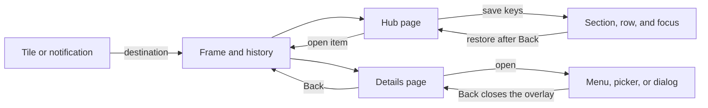

# User flows and behavior

[Table of contents](../README.md) · [Principles](foundations.md) · [Components](components.md) · [Sources](sources.md)

Each flow defines the implementation contract and the expected result of each transition. The examples use fictional applications. The history, gesture, and state restoration rules are library rules. The links show comparable platform behavior.

## State owners

| Owner | State it stores | How it uses the state |
| --- | --- | --- |
| Host | Shell capabilities, external activation, environment settings, available space | Passes events to the application and performs system operations through an adapter. |
| Frame | Current `routeId`, parameters, and keyed history entries | Saves the outgoing page state. Handles Back and activates the next page. |
| Page | Container, navigation source, local modes, draft, and rules for leaving | Registers visible commands and handles unfinished work. |
| Hub / Pivot / TabView | Active section or tab and its local state | Sends the confirmed selection to the page. An independent document can have its own navigation context. |
| Document tab window | Key order and active tab | Accepts a transfer and activates the session. Closes the temporary window after its last tab returns. |
| Collection | Anchor `itemId` and offset, selected keys, selection mode, and expanded groups | Calculates visible rows from the data. On return, it restores the anchor after loading and layout. |
| Shared selection | Selected keys and selection order | Keeps selection in sync across sections. Gives the command bar one set of targets. |
| Queue | Keyed entries, processing order, and current position | Receives records when the user adds them. Passes the active entry to the player. |
| Transfer session | Source keys, pending operation, and proposed insertion point | Shows a preview at the target. The collections update after confirmation. |
| Overlay | Trigger, focus scope, dismissal rules, and draft selection | Handles input while open. Restores focus on close. |
| Data model | Objects, query results, local drafts, and save state | Supplies current data when the user returns. The page restores its saved position in that data. |
| Synchronization | Stable submission IDs, confirmed versions, and the last attempt result | Updates the save state in local storage. The list and editor show the result from the same model. |

Each page visit has its own view snapshot, even if the user visits the same route again. On Back, the page restores the position and filter from that visit. It reads the current content from the data model. The snapshot stores IDs, filter settings, and a format version. If part of the snapshot is out of date, the page restores the valid fields and selects the nearest useful position. [Pages and frames in Phone Store apps](https://web.archive.org/web/20140501211142id_/http://msdn.microsoft.com:80/en-us/library/windows/apps/dn596119.aspx)

## Windows Phone app structure models

Microsoft has described seven models for Phone 8 and 7.1, including the Utility Device and the game interface. The five models in the Phone 8.1 article cover menu review, peer-to-peer panel review, Pivot, a list of details, and flipping through the same type of pages. Microsoft allows for combinations. For example, one review section displays a short list, and an open object gives its own Pivot with tabs. [App structure and navigation models](https://web.archive.org/web/20121102145906id_/http://msdn.microsoft.com/en-us/library/windowsphone/design/hh202903(v=vs.105).aspx) · [Navigation patterns for Phone 8.1](https://web.archive.org/web/20140523051618id_/http://msdn.microsoft.com:80/en-us/library/windows/apps/dn596118.aspx)

| Microsoft model | What the script is all about. |
| --- | --- |
| Central hub with home-page menu | The home panel gives explicit inputs to the sections. Neighboring panels give quick access to some of the contents of these sections. Frame opens a partition or object for a selected purpose. |
| Central hub with panel areas | Each panel itself represents the upper level area. Her subjects reveal details. The example of Microsoft shows how one line can have different goals for the post and the profile of the author, and the profile opens its Pivot. |
| App tabs | Separate representations of the same context, often different filters. Pivot has an active view, Frame keeps the history of pages. A generic App Bar works if its commands apply to each tab. |
| List with details drilldown | Activation of the line opens the selected object. The list remains a point of return with a remembered position. The list can be the start page or the content of the Hub or Pivot section. |
| Uniform page shuffle | The pages are arranged in the same way and show different objects of the same kind. In Phone 8.1, Pivot is offered for flipping. Set settings allow you to add, remove and rearrange objects. |
| Utility device | The main screen is organized around a specific task and its direct control. |
| Game design | The historical table of contents highlights scenarios based on Silverlight and XNA. |

For a standalone panel model, Microsoft recommends up to four areas. At the start, this model allows you to open the first panel or return to the last selected one. The Phone Hub’s guide lists up to five sections. For a review from the home menu, a separate direction leads to the task page. Back from it returns to the view before moving to another area. [Independent panels of Phone 8.1](https://web.archive.org/web/20140606145944id_/http://msdn.microsoft.com:80/en-us/library/windows/apps/dn596101.aspx) · [Hub with Phone 8.1 Home Menu](https://web.archive.org/web/20140606145135id_/http://msdn.microsoft.com:80/en-us/library/windows/apps/dn596100.aspx) · [Phone Hub, pp. 131-135](sources.md#2014-pdf-page-map)

The App tabs guide for Phone 8.1 shows Pivot with filters of the same set and with different representations of a common subject. The title gives you a direct selection of the tab. When the context changes, the App Bar outputs commands for the current content. [App tabs in MSDN](https://web.archive.org/web/20140430155135id_/http://msdn.microsoft.com/en-us/library/windows/apps/dn596099.aspx) · [List with details of drilldown in MSDN](https://web.archive.org/web/20141006051436id_/http://msdn.microsoft.com:80/en-us/library/windows/apps/dn596115.aspx)

In the Windows 8.1 desktop branch, the Hub hierarchy → section → details are suitable for large collections. The flat model allows you to switch between equal pages, tabs or modes through the content or top panel. In a long review, Semantic Zoom gives an additional way to go to the section. [Navigation patterns for Windows Store apps](https://web.archive.org/web/20140417010223id_/http://msdn.microsoft.com:80/en-us/library/windowsphone/design/hh761500.aspx)

## 1. Open details and return to the overview

1. Open the Catalog app on Hub. Swipe from **New** to **Favorites**. The page receives the confirmed `sectionId` when the move stops.
2. Select a card. The app saves the `sectionId`, `itemId`, list position, and focus target. Frame opens the route for that card. A separate section link opens all favorites.
3. Select Back. The app restores **Favorites** with current data. If the item still exists, it scrolls the card into view and restores focus.
4. If the card no longer exists, focus the nearest available card or the section heading. If the collection is empty, show an explanation and the next available action.

**Check.** Two horizontal swipes result in one current Hub position. Opening a card adds one history entry. One Back request returns to the source card. The motion setting changes only the visual transition. [Phone Hub, pp. 131–135](sources.md#2014-pdf-page-map) · [Connected animation](https://learn.microsoft.com/en-us/windows/apps/develop/motion/connected-animation)

## 2. Use Pivot to switch filters

1. On the Records page, there are sections called All, New, and Marked, which are computed from a collaborative data model, each with its own scroll anchor.
2. The header, swipe, and keyboard lead to one filter change event, and the Frame stays on the current page, and the recording details are accessed in a separate transition.
3. The data is updated. If there are no new entries now, the section shows the text of the empty state. The result of the update does not, by itself, move the user to the adjacent section.
4. Returning from the parts restores the filter, and if the recording no longer matches it, the view saves the partition and returns the focus to the neighbor or the header.

In the Microsoft WinJS sample, switching the list to multiple choice mode sets `Pivot.locked`, and touching the string switches its selection. At the end of the Pivot mode, the list is unlocked and the record is activated again. For a library, it's a choice in one section. [Sources Phone 8.1](windows-phone-archive.md#sample-source-analysis) · [Compilation of several sections](#28-select-items-across-sections-and-add-them-to-a-queue)

The **Check.** Back leads in detail to the last filter. On the Back page, it first completes the active selection, then returns to the previous route. When selecting a header in one section, the gesture and keyboard switch the filter again after leaving the mode. The cycle in the Metro profile runs in both directions and does not duplicate items for accessibility tools. [Phone Pivot, pp. 161–164](sources.md#2014-pdf-page-map) · [WinUI Pivot](https://learn.microsoft.com/en-us/windows/apps/develop/ui/controls/pivot)

## 3. Back closes the current context

A single Back request is processed once for the current input context. Below is the order of dispatch in the library. For a browser, desktop window, and device with system back, the last step is determined by the host adapter.

When certifying Windows Phone, Microsoft checked the closure of the dialog, context menu and on-screen keyboard, return from the nested page and exit from the main one. Confirmation of exit was allowed on the main page. The games had a separate rule for pausing while playing. [Specifications, section 5.2.4](https://web.archive.org/web/20140424024354id_/http://msdn.microsoft.com:80/en-us/library/windowsphone/develop/hh184840(v=vs.105).aspx) · [Discussion of Microsoft inspections](https://blogs.windows.com/windowsdeveloper/2014/01/10/top-windows-phone-app-certification-failures-and-how-to-avoid-them/)

In desktop Windows Store 8.1, a separate guide describes the on-screen Back button for hierarchical transitions. In a flat structure, the sections open through the contents or the top panel. In the phone, the hardware back rules are set by the shell. [Guidelines for back buttons](https://web.archive.org/web/20140413025233/http://msdn.microsoft.com/en-us/library/windowsphone/design/dn439322.aspx)

| Current state | First Back request | Next Back request |
| --- | --- | --- |
| An overlay is open above the page | Close the top overlay if it allows dismissal. An overlay that requires a response keeps control until it has a result. | Handle the new topmost context. |
| The system keyboard handles Back | The host closes the keyboard. Fields retain their input. | Apply the app's Back policy. |
| Temporary search or multiple selection is active | Exit the mode. If search has its own route, use Frame history. | Go back in history. |
| The editor has an unsaved draft | Ask the user to confirm leaving. Keep the original route. | Cancel the confirmation if the dialog allows it. |
| A details page has a previous history entry | Return to the previous entry. | Handle the context of that page. |
| Application history is empty | Let the host handle Back. For example, the device shell can return to the previous system surface. | Follow the host policy. |

**Check.** On a page with a draft and an open picker, the first Back closes the picker. The second asks for a draft decision. If the initial control is already removed at the end of the transition, the focus goes to the stable element of the current page. [Back button, Phone 7 guide, page 110](https://tableless.github.io/exemplos/pdf/guidelines-interface-mobiles/UI%20Design%20and%20Interaction%20Guide%20for%20Windows%20Phone%207%20v2.0.pdf#page=56) · [Navigation history and Back](https://learn.microsoft.com/en-us/windows/apps/design/basics/navigation-history-and-backwards-navigation)

## 4. Top-level items and document position

1. In a wide window, Projects open through the NavigationView side window, in a narrow window, through the adaptive panel, and the width change saves the selected item, page, and settings.
2. The app specifies the history policy for the top-level items. Replacement of the current section may apply for equal paragraphs. When moving into detail, a record in history is used.
3. BreadcrumbBar Projects/North/Tasks allows the transition to the specified ancestor. The history is updated according to the policy of the specific application. The selected navigation and header are calculated from the active route.
4. With independent TabView tabs, switching saves the state of each. Closing the document checks its draft, closing the adjacent tab saves the current context.

The **Check.** Deep link highlights Projects. After Back, the active point corresponds to the route. Breadcrumb transition works even with a short history of visits. [Navigation basics](https://learn.microsoft.com/en-us/windows/apps/design/basics/navigation-basics) · [NavigationView, BreadcrumbBar and TabView](sources.md#winui-control-reference-links)

## 5. Overflow, context commands, and confirmation

1. "Add" is constantly visible on the page. "Export" is available at the ellipsis. For the line "Record 34", the context menu suggests "Rename" and "Delete".
2. The ellipsis opens overflow. In the Phone profile, the opening also shows icon labels. Back and re-press the ellipsis close the layer. The keyboard returns to the trigger.
3. "Delete" remembers the record ID, closes the menu and opens the dialog. Cancellation saves focus and recording. When confirmed, the button shows execution and protects against repeated request.
4. When successful, the focus is moved to the next visible line, and if the error is recorded, the result is displayed where the user can repeat the action.

The **Check.** context of right-click, retention, and keyboard allows the same target entry. If the entry has disappeared while the menu is open, the confirmation leads to a secure termination with understandable status. [Phone Application Bar, pp. 30–37](https://tableless.github.io/exemplos/pdf/guidelines-interface-mobiles/UI%20Design%20and%20Interaction%20Guide%20for%20Windows%20Phone%207%20v2.0.pdf#page=16) · [Commandbar and Dialogs](sources.md#winui-control-reference-links)

## 6. Long lists, group navigation, and selection

1. In the Authors list, the group title opens an overview of the letters. Desktop profile can add input through Semantic Zoom.
2. In the review, selecting a letter returns the detailed list to the first available group element. Cancellation returns the previous anchor. After localization, the letters are taken from real grouped data and sorted according to the rules of the language.
3. In the list, the "Select" action enters the tick mode. The tap switches the selectedId on the line. The panel shows the number and commands for the dial.
4. Back from Select Mode returns normal activation. Changing the filter follows a clearly defined policy. If the hidden records are stored in the sample, the counter and the context of the operation include them in a manner visible to the user.

**Check.** Virtualization does not change selected keys when scrolling. The remote identifier disappears from the selection. The group command allows the entire current set of selected keys, including strings outside the scroll area. [LongListSelector SDK](https://learn.microsoft.com/en-us/previous-versions/windows/apps/jj208486(v=vs.105)) · [Semantic Zoom](https://learn.microsoft.com/en-us/windows/apps/develop/ui/controls/semantic-zoom) · [ListView and GridView](https://learn.microsoft.com/en-us/windows/apps/develop/ui/controls/listview-and-gridview)

## 7. List and details on narrow and wide screens

1. On a narrow screen, the choice of a project opens the details to the entire screen available, the list remembers the anchor and the activated line.
2. As the width increases, the parts become the adjacent panel. The original selectedId and the state of the editor are saved. Frame adapts the presentation of the current destination without additional user transition.
3. When choosing another project from a wide panel, the details change, and the rule of unsaved draft applies before the shift.
4. When narrowed, the open details again occupy the screen. Back shows the list in its previous context. Broadly, the Back policy can either remove a choice or return to a previous location, depending on the history record made.

**Check.** After several width changes, the object, error status, and text input remain the same. The change in width retains the size of the transition log. [List/details](https://learn.microsoft.com/en-us/windows/apps/develop/ui/controls/list-details) · [TwoPaneView](https://learn.microsoft.com/en-us/windows/apps/develop/ui/controls/two-pane-view)

## 8. Search and suggestions

In the Phone 8.1 manual, the Search hardware key belongs to the system search. The internal search application opens through its own field or command. [First look at Windows Phone](https://web.archive.org/web/20140531182055id_/http://msdn.microsoft.com:80/en-us/library/windowsphone/design/dn596110.aspx)

1. The visible command opens the field or search route, the focus goes to the field, and the IME completes the composition before the request is sent.
2. The tips use the current text. Each response is associated with its query, a late response does not replace current prompts. The choice of an offer or Enter performs the stated action: fills in the request or opens a specific result.
3. The states of the results list distinguish between empty input, loading, no matches, result and failure. A page search works with the current screen and can show a match number.
4. Back closes the open prompts, then returns according to the rules of the overlay or route, the return from the result saves the request and position.

**Check.** With a sequence of "a", "av", "aut", the results of the last request are available to the user. When you enter the keyboard, the arrows select the sentence, the available field name is saved. [Search in Guide 2014, pages 184 and 302](sources.md#2014-pdf-page-map) · [AutoSuggestBox](https://learn.microsoft.com/en-us/windows/apps/develop/ui/controls/auto-suggest-box)

## 9. Form, picker and unfinished draft

1. Opening the editor loads the source data separately from the draft. The changed meaning makes the form dirty. The field error is related to the label, the value and the place of correction.
2. The date selection opens the picker with a time value. Accept saves it in the draft of the page, the cancellation restores the former. The external keyboard and touch can make the same choice.
3. Save validates the draft, blocks re-launch, shows progress of appropriate scale, and if it fails, the input values remain available.
4. Leaving with changes opens up a dialogue with clear options to stay, reject changes, or save if available. If successfully maintained, the original requested transition continues once.

**Check.** Picker cancellation doesn't make the shape dirty. Escape closes the picker in the picker, Back with the changed form opens the confirmation. The result of one save is not processed twice. [Forms, dialogues and pickers WinUI](sources.md#winui-control-reference-links) · [Guidelines for form layouts, page 314](sources.md#2014-pdf-page-map)

## 10. Swipe, scroll, and axis conflicts

1. The pointer presses the line in Pivot. The line shows the press, and the decision to activate is waiting to be released.
2. After overcoming the threshold of movement, possession is taken by one participant. Vertical motion processes the list. Horizontal belongs to Pivot unless the area is explicitly delegated to the nested control. The edge system gesture is involved with the host priority.
3. If the cards need their own horizontal swipes, they get a separate screen or a designated capture area. Each gesture has an accessible command via a menu or button. Retention is cancelled at the start of drag.
4. When releasing, the owner completes the movement or returns the previous position. With `pointercancel`, loss of grip or change of orientation, the press is cleared, capture is released, and the last confirmed state is maintained.

**Check.** Diagonal motion around the threshold does not jump between owners. A completed swipe does not cause a click on the line. Repeated tap after release of capture works. [Phone Pivot and Phone Hub](sources.md#2014-pdf-page-map) · [Touch interactions](https://learn.microsoft.com/en-us/windows/apps/design/input/touch-interactions) · [SwipeControl](https://learn.microsoft.com/en-us/windows/apps/develop/ui/controls/swipe)

## 11. Refresh, empty state, and error

1. At the first input without data, the loading inside the area is displayed. With available data, the display remains interactive when updated. The indicator disappears after termination, cancellation or error.
2. The update can trigger a gesture, a panel button, or restore the connection. One actual query is used for a given area at the same time, or the result of each query is verified by generation.
3. When successful, the anchor is retained, new entries are given visible positions, and completion is briefly announced. The empty collection has its own explanation. A glitch with old data shows inline status and repeat. Failure without data gives a state of error on the site of the collection.

**Check.** Update Error Leaves Old Records Interactive Cancellation does not show error as a result. Repetition allows you to get the data and returns the indication to normal. [Phone Hub and Progress Controls](sources.md#2014-pdf-page-map) · [Pull-to-refresh](https://learn.microsoft.com/en-us/windows/apps/develop/ui/controls/pull-to-refresh) · [InfoBar](https://learn.microsoft.com/en-us/windows/apps/develop/ui/controls/infobar)

## 12. Tile pinning, updates, and activation

1. From the "Route to the Park" card, the user calls "Secure". The host confirms the system anchorage where it is supported. After the cancellation, the UI remains in its previous state.
2. Tile associates the identifier with the route and parameters. The small size shows the main designation, the larger adds information. The background publication updates the content and the relevance period.
3. By clicking on the tile, the host transmits the parameters to the router. It resolves them at a cold start and with an active application. The missing object opens a state of inaccessibility with access to the corresponding section.
4. The necessary login to the account leads through an intermediate route. After completion of the entrance, the original appointment is resumed. Back from a cold-open detail follows host policy or an explicitly constructed parent story.

**Check.** Two different objects give different purposes. Removing the fixing removes the shell record and saves the object itself. Text and counter do not disclose hidden data after a change of account. [Phone 8 Start](https://blogs.windows.com/windowsexperience/2012/11/02/the-story-behind-the-windows-phone-8-start-screen/) · [Secondary tiles design guidance](https://learn.microsoft.com/en-us/windows/uwp/launch-resume/secondary-tiles-guidance)

In Phone 8, creating a secondary tile puts the user on Start. Back was returning to the app. The visible command could switch from fixing to removing fixing according to the state of the selected object. In the library, the transition to the shell and placement confirmation is handled by a specific host adapter. [Tile design guidelines for Windows Phone](https://learn.microsoft.com/en-us/previous-versions/windows/apps/jj662929(v=vs.105))

## 13. Toast, notification center, and reactivation

In Phone Store apps, tile, toast and raw notification serve different situations. In this scenario, a notification of a new event appears on the tiles if it is enough to report it, or in the toast if the action is appropriate for the person now. The raw notification data is processed in the application and can change its state. [Essential graphics, visual indicators, and notifications](https://web.archive.org/web/20141012014027id_/http://msdn.microsoft.com:80/en-us/library/windows/apps/dn596109.aspx)

1. A new event updates the model, and the app sends the host short text and destination for the toast, or updates the counter of the corresponding area.
2. The toast expiration leaves the app on the current route. Activation from a toast or notification history transmits one type of assignment that can be resolved in an open or closed process.
3. The object has already been read or deleted. When re-activated, the application shows the current state and a clear path to the associated section. The notification and the counter are updated according to the model events.

**Check.** Activating a single notification twice does not create a duplicate screen if the destination is already open. The meter reflects the data, and actions are available even after the short surface disappears. [Phone 8.1 Action Center](https://blogs.windows.com/windowsexperience/2014/04/02/cortana-yes-and-many-many-other-great-features-coming-in-windows-phone-8-1/) · [Tiles and Notifications, pp. 355–388](sources.md#2014-pdf-page-map)

## 14. System pickers, Share, and the app boundary

1. The "Enclose File" command opens the system picker. The page saves the draft and associates the external request with its context.
2. The cancellation leaves a draft. After the result, the ability to open the file and the existence of the original page are checked. If the context is restored, the file is added once.
3. The "Share" command transmits the data selected by the user to the system surface. When receiving data, the application first shows the available action and destination of the import.
4. When the focus is temporarily lost, the page retains its position. If the system integration is missing, the interface uses the available path for the same operation when it is available.

Phone 8.1 sends a request via `PickSingleFileAndContinue`. The next time you activate it, the application prepares Frame and restores the state if the process has been completed. `ContinuationManager` then forwards the event to the current page. The page displays the name of the selected file or the cancellation message. In the library, the query further stores the draft key so that the restored form can verify the identity of the result. [File picker sample source](windows-phone-archive.md#sample-source-analysis)

To open a file in an external application, the Windows Store guide describes delegation to the system. If you want to select a handler, the shell shows Open With next to the initiator. The application transmits a file or URI and a call point. [Guidelines for file types and URIs](https://web.archive.org/web/20140502075523/http://msdn.microsoft.com/en-us/library/windowsphone/design/hh700321.aspx)

**Check.** Closing the system window does not duplicate the tool, the error can be fixed without losing work, the result of the late picker does not update another object. [Contracts, Share and File Pickers, pp. 25–85](sources.md#2014-pdf-page-map) · [Comparison of Windows 8 and Phone 8](sources.md#windows-phone-8-and-windows-8)

## 15. Suspension, restoration, and environment changes

1. After switching from the application, the host gives you a chance to save the state. Frame captures a minimal snapshot of the route, current section, anchor, filter, and draft if it is intended to be recovered.
2. When returning, the warm process first uses the current model and compares the data. In cold recovery, it uploads the picture, checks the route and parameters, recovers data and layout, then position and focus.
3. Explicit external activation is permitted regardless of the stored route. If the user has been in the editor, the host applies the announced draft policy prior to the change of destination.
4. When an external screen appears or the size changes, an appropriate layout is built. The possibility of independent representations and input is determined by the host as for the historical Continuum.

**Check.** The missing recording leads to the immediate context. Re-restore does not repeat the data record. After changing the size or theme, the unfinished task remains available. [Tombstoning and the Zen of Async](https://learn.microsoft.com/en-us/archive/msdn-magazine/2012/october/windows-phone-tombstoning-and-the-zen-of-async-for-windows-phone) · [Continuum for phones](https://learn.microsoft.com/en-us/windows-hardware/design/device-experiences/continuum-phone)

## 16. Theme and behavior settings

1. The "Design" section opens with the usual route, the switch turns on the instant rule, and the radio group sets the "System", "Light" or "Dark" mode.
2. When selecting, the application updates the general set of tokens. The selected lines, the current section and the open dialogue retain the identity. The new focus color remains visible on the current surface.
3. In System mode, the change in the theme or accent comes from the host. The locally selected theme remains the user’s explicit value. A save error displays the actual state and access to a repeat attempt.
4. When the system contrast theme is included, the active states receive contrasting brushes. Open dialogue, list highlighting and focus are maintained. After leaving the contrasting theme, the previously chosen mode operates.

**Check.** Changing the system theme during editing changes the design of the field, saving the cursor and draft. In open dialogue, the contour of the focus is seen in a contrasting theme. Re-entering the settings shows a previously recorded mode. [Theme resources for Windows Phone](https://learn.microsoft.com/en-us/previous-versions/windows/apps/ff769552(v=vs.105)) · [ThemeResource in WinUI](https://learn.microsoft.com/en-us/windows/apps/develop/platform/xaml/themeresource-markup-extension) · [ToggleSwitch](https://learn.microsoft.com/en-us/windows/apps/develop/ui/controls/toggles)

## 17. View media, enter full screen, and zoom

1. From the Album grid, an object with the original itemId opens. FlipView uses neighbors in the same order as long as viewing preserves this collection context.
2. At a normal scale, the gesture flips through the photo. In the enlarged image pan controls its position, pinch changes the scale. Explicit buttons or keys are available to navigate to a nearby object. If the item is gone, the view shows the nearest available object or returns to the collection.
3. Full-screen mode changes the visibility of the panels, keeping the available way to take back control. The host continues to display system notifications according to its rules. Back first closes the temporary mode, then returns to the original list. The buffer indicator and the playback position store different states.

The **Check.** Pan magnified image leaves the same itemId. A rotating or resize keeps the object open. After returning from full-screen viewing, the focus is available on the panel or in the original collection. [Full-screen mode and orientation of Phone 8.1](https://web.archive.org/web/20140501211142id_/http://msdn.microsoft.com:80/en-us/library/windows/apps/dn596119.aspx) · [FlipView, ScrollView and Media Playback](sources.md#winui-control-reference-links)

## 18. Switch between pages of the same type

1. In the prediction app, each page uses a single layout for a separate city. Cities have stable keys and user order. Switching swipes, buttons, or keys changes the current key inside the set.
2. The App Bar opens up dial management. "Add City" leads to a search, after selecting the city is included in the set. There is also a change of order and removal. When rearranged, the active key is saved, and when removed, the next available city or empty state opens.
3. Back is leaving set management for viewing. Flipping by itself does not create a new route record for each city. When you return from the forecast for a separate day, the city key and the scroll context are restored.

**Check.** Rearrangement of cities preserves the current city. After removing the current city, the expected neighbor opens, and an add command is available for an empty set. The swipe and available buttons select elements in the same order. [Uniform page shuffle for Phone 8.1](https://web.archive.org/web/20140618190016id_/http://msdn.microsoft.com:80/en-us/library/windowsphone/design/dn596124.aspx) · [View elements inside the Phone 8.1 page](https://web.archive.org/web/20140501211142id_/http://msdn.microsoft.com:80/en-us/library/windows/apps/dn596119.aspx) · [FlipView](https://learn.microsoft.com/en-us/windows/apps/develop/ui/controls/flipview)

## 19. Take, confirm, and reopen a photo

The Phone 8 Lens opened the viewfinder from the system camera. Microsoft has described direct save and capture with confirmation. Later, the system viewer could open the created image in the application if the image had a linked viewing or editing mode. In the library, this is a script for a host that supports external image activation and transfer. [Lens design guidelines for Windows Phone](https://web.archive.org/web/20121103005627/http://msdn.microsoft.com/en-us/library/windowsphone/design/jj662922(v=vs.105).aspx)

1. The host transmits the launch context. Frame opens the viewfinder where capture and output are available. Recalculating the geometry after a turn saves the clearly selected camera modes.
2. With direct capture, the result is saved through the host, and the viewfinder receives the next input after the save confirmation. In the mode with verification, a temporary picture is created. "Save" records it, "Cancel" releases temporary data. Both results are returned to the viewfinder.
3. When you run a photo from view, Frame opens the associated object by ID. The action "Save a copy" becomes available after editing. It leaves the user on the edit screen with a confirmed result. Back returns to the selected photo in the system viewer via the host.
4. If additional information about the image is not available, the page shows the standard image available or informs that the object is no longer available. Reconservation must be a separate, confirmed operation.

**Check.** Cancel on the preview screen leaves the number of saved shots the same. When you start from a view, details are opened for the selected shot. After saving the copy, the result is visible on the current screen. Loss of Linked Data gives you access to or view the available image. [Lens Recommendations for Phone Store Apps](https://web.archive.org/web/20140408235720id_/http://msdn.microsoft.com:80/en-us/library/windowsphone/design/dn596114.aspx) · [Lens in consolidated PDF, page 33](https://tilsgee.github.io/DesignGuidelinesArchive/uwp8.1.pdf#page=33)

## 20. Adaptive command bar

1. In a wide list of documents, the panel shows "Create", "Sort" and "Filter". Additional actions are available through the ellipsis. The Filter has an apparent switch state.
2. When the panel is narrowed, the "Filter" is transferred to the menu. Its current state and keyboard action remain available. After increasing the width, the command reappears on the panel if it fits.
3. Selection of lines substitutes commands for selected documents. The transfer of these commands changes the visible location, preserving the target identifiers. When the entire selected set disappears, the open context menu closes and the focus returns to the list.
4. An open command checks the availability of the target before execution, and the change in width during execution keeps the state of the operation and the outcome in one place.

**Check.** Before and after the transfer, the Filter opens the same setting, and its activation coincides on the panel and in the menu. The focus remains in the accessible part of the surface. When you change the selection during the open menu, selected documents are not processed randomly. [CommandBar](https://learn.microsoft.com/en-us/windows/apps/develop/ui/controls/command-bar) · [Collections and direct management](components.md#collections-and-direct-manipulation)

## 21. Lock screen and primary tile

1. The user selects in the shell settings an application for status and, if necessary, a separate background provider. The host informs which roles are available and included.
2. The event updates the main tiles and related views. For fast status, the host receives an icon and an available counter value. A short text is used for detailed status. In the historic Phone 8 adapter, text for Flip is taken from a wide or medium tile according to the rules of the platform.
3. When the background is not received, the host uses a standard image. Disabling the status stops its publication on the lock screen. Start tiles continue to work on their own settings.
4. After opening the application and watching the events, the model recalculates the counter, and the adapters get the same value the next time they publish.

**Check.** Disabling the lock screen status removes it from that surface. Setting a zero counter removes the number. In the absence of broad Flip tile data, the historical profile uses medium text. [Phone 8 Lock Screen Guide](https://learn.microsoft.com/en-us/previous-versions/windows/apps/jj662927(v=vs.105)) · [Guide to Phone Store Apps](https://web.archive.org/web/20140408235720id_/http://msdn.microsoft.com:80/en-us/library/windowsphone/design/dn596116.aspx)

## 22. Shared collection with phone and desktop navigation

In 2015, the Windows team described a design version of Photos, where on the phone between the collection and the albums you can flip Pivot with one hand, and on the PC the same areas open through the menu. This is an example of selecting a view during Windows 10 development. [Windows 10 Design](https://blogs.windows.com/windowsexperience/2015/04/29/windows-10-design-getting-the-balance-right/)

1. The two destinations "Collection" and "Albums" have permanent keys. A narrow profile with a touch displays them in Pivot, a desktop one in NavigationView. Both methods select one active partition model.
2. Switching to a separate photo creates a story. When you change the input device or window in an already open photo, the selected section and photo are saved. The shell adjusts the presentation to the available place.
3. When you return from a photo, Frame restores the original section and anchor of the collection. The focus state is translated to the visible element of the current layout if the previous node is no longer available.
4. NavigationView's software choice reflection updates the selected item when it is restored, and the transition request is processed only once.

**Check.** The Pivot swipe and the NavigationView option open one data partition and keep the same browsing history. Back from the photo returns to the preset entry in all profiles. [NavigationView](https://learn.microsoft.com/en-us/windows/apps/develop/ui/controls/navigationview) · [List/details](https://learn.microsoft.com/en-us/windows/apps/develop/ui/controls/list-details)

## 23. Run a command by voice

In Phone 8.1, the system voice command could run a specific task. For recognition inside the application, the guide offers an explicit microphone button in the App Bar and an example phrase for the current screen. With low confidence, he suggests requesting confirmation, and after several unsuccessful attempts to give text or close recognition. For a short list of valid phrases, the Phone 8.1 supported local recognition. Built-in dictation required a network. [Speech design guidelines](https://web.archive.org/web/20141022104513id_/http://msdn.microsoft.com/en-us/library/windows/apps/dn596121.aspx) · [Cortana integration and recognition patterns](https://blogs.windows.com/windowsdeveloper/2014/09/23/cortana-integration-and-speech-recognition-new-code-samples/)

1. The microphone button triggers recognition through the host. The states "listen", "process" and "stopped" are displayed in text and are available for voiceover. Cancel returns focus to the button.
2. The recognized phrase is allowed in the command and parameters. The ambiguous result opens up a list of matches with the available choice. The error leaves a way to try again or perform an action through the screen.
3. System activation transmits the same purpose through the adapter. Frame opens the right place. If the action requires confirmation, the launch prepares the action and shows its final purpose.
4. After derecognition, the late result is absorbed by the request identifier. A new launch receives a new identifier and inherits only the stable context of the page.

**Check.** Speech and Visible Command open a single assignment. The ambiguous result keeps the source screen up to selection. Cancellation clears the indicator and protects against late opening of another route. [System Contracts for Windows Phone 8.1](sources.md#windows-81-and-windows-phone-81)

## 24. Hub with mixed data and partial loading

1. On a wide screen, the directory's Hub shows priority content, then selections, recent entries, and a separate help section. Each section has its own data source and key. For the first display, visible sections are prepared. The rest are downloaded without blocking the already visible content.
2. The title of the collection with action opens the entire list of collections. Entrance through the card opens a specific object. The keyboard transition to the header of the adjacent section leads it to the visible area without the Frame recording.
3. If one section is loaded with an error, it shows a repeat. Other sections and their teams remain available. The late result of the deleted section checks the key and version of the request before updating.
4. In a narrow desktop window, the Hub has the same sections vertically. After returning from the parts, the selected section and the support element are restored. When changing the axis, the previous displacement is used only in compatible geometry.
5. A review of the sections by Semantic Zoom leads to the selected section by the same key. Back from the page with all the contents of the section restores the original Hub.

**Check.** The visible part is available when the background load is incomplete. The error does not block the opening of the card. Re-entry after the width change returns to the meaningful element. Selecting a section in the review changes Hub's position, and opening a detailed page adds a Frame entry. [Hub for heterogeneous data](https://blogs.windows.com/windowsdeveloper/2014/02/05/introducing-the-new-hub-control-for-heterogeneous-data/) · [Semantic Zoom in WinUI](https://learn.microsoft.com/en-us/windows/apps/develop/ui/controls/semantic-zoom)

## 25. Phone Hub and current section commands

1. Hub has three sections, Review, Recent, and Favorites. The initial section has a minimal panel. Global app commands are available through the menu.
2. The user flips to "Recent". When this section becomes the first visible, the panel shows the main command "Clear Recent" in compact mode. The edge of the next section on the screen saves a hint about the possibility of flipping.
3. The user scrolls further. The panel hides the section command and returns to minimal mode. If the menu is already open and the context has changed, the library closes it and returns the focus to the current section.
4. A card from "Recent" reveals the details. Back restores the section, the reference line and the panel with the commands of this section. The command call transmits the section ID, and the confirmation checks the relevance of the context before application.

**Check.** The partially visible section does not intercept the panel from the first visible section. Flipping does not add a Frame record. After the return, the same commands are available. In the two-section variant, the flipping stops at the boundaries. [Phone Hub and AppBar in Microsoft Sample](https://blogs.windows.com/windowsdeveloper/2014/07/22/tips-and-tricks-for-using-xaml-controls-in-your-universal-windows-apps/) · [Procedure for processing Back](#3-back-closes-the-current-context)

## 26. Open a map and return to a selected location

1. The "Nearby" section in Hub shows a static map preview and a list of places. Flipping over the preview remains a Hub gesture. Clicking "Open Map" creates a Frame entry with a search area, section key, and focus return point.
2. The map occupies the main area of the page. Touch and keyboard allow you to move around the map, change the scale and open the available list of points. The saved area and the current selection work without geolocation. If a user requests their location, the card uses the result provided by the host.
3. Selecting a tag updates the built-in description in the map bar without a record in history. The command from the description opens the site page. Frame remembers the selected point, the boundaries of the visible area and the scale, and the map updates the data regardless of position.
4. Back from the card restores the map with the previous area and returns the focus to the brief description. If the dot is gone, the map saves the area and shifts the focus to the list of places. The next Back returns to the button that opened the map in Hub.

**Check.** Swipe previews the Hub. After opening the card, the same gesture pans the map. Two Back presses are returned first to the map and then to the previous review section. Failure to geolocate leaves available manual movement and points from the current area. [Phone Hub](https://web.archive.org/web/20140408233046id_/http://msdn.microsoft.com/en-us/library/windowsphone/design/dn596112.aspx) · [Guidelines for Maps](https://web.archive.org/web/20140408235720id_/http://msdn.microsoft.com:80/en-us/library/windowsphone/design/dn596102.aspx)

## 27. Shell activation and a shared player

The Microsoft information architecture template lists three system entry points to the music app. Inside, there's a login and login branch, Panorama, search, library, recent entries, contextual actions, and several paths to the player. [IA Sample, archival PDF](https://web.archive.org/web/20121118220154id_/http://cmsresources.windowsphone.com/devcenter/en-us/downloads/IA_sample.pdf)

1. The host adapter accepts the launch from a list of apps, tiles, or music surfaces. Frame authorizes appointment. If it needs to log in to the account, the application stores the unfinished appointment and opens the login form.
2. The login error leaves the form and assignment available for repeat. Successful entry applies the appointment once. Explicit cancellation removes the delayed transition. Once launched, the overall review becomes the entry point to the library, recent entries, and search.
3. Activation of the record opens the player with the record key and the context of the queue. The player owns the position and playback. The screen from which the recording was opened stores its position and filter. The menu of the current record receives the same key, so its commands refer to the displayed record.
4. Back closes the player’s open menu, then restores the list or search with the same filter. The state of playback is maintained according to the rules of the host. The reopening of the current record picks up its saved position.

**Check.** You can access the same object from search and recent entries. After closing the player, each entry point regains its position. A successful entry after an error applies a delayed transition once. Cancelling entry clears appointment. [Application structure template](https://web.archive.org/web/20121118220154id_/http://cmsresources.windowsphone.com/devcenter/en-us/downloads/IA_sample.pdf) · [System activation and return](#12-tile-pinning-updates-and-activation)

## 28. Select items across sections and add them to a queue

1. In the Audio Records collection, tap opens the recording. In the Windows Store profile, a short cross-slide across the scroll marks the record. The "Select" command gives the same result without a gesture.
2. The user moves to another group and notes another entry. The collection shows both records with available titles. The counter and the command panel rely on the same keys, so scrolling or filtering does not change the composition of the selection.
3. The "Add to the queue" command resolves the keys and creates the queue positions in the visible order of the collection. The order of reproduction after addition is owned by the queue. Another explicit addition of the same record creates a separate position.
4. Back from an open selection closes its view and returns the focus to the trigger button. When the record disappears from the catalog, the collection updates the counter. If this happens when you add, the result of the command tells you which entry is missed.

**Check.** A short tap opens the recording, a cross-slide marks it. Switching the group saves the counter and selected keys. Re-addition creates a separate queue position, and in the collection, the record remains the only one. [Guidelines for cross-slide](https://learn.microsoft.com/en-us/windows/apps/develop/input/guidelines-for-cross-slide) · [Player and context of the queue](#27-shell-activation-and-a-shared-player)

## 29. Drag and reorder

1. The user selects the records and starts the transfer by the handle. The source captures the keys and the original version of the list. Before the motion is captured, scrolling and string activation are processed in the usual way.
2. When hovering between the elements, the target shows the insertion location and the operation available. A preview can shift adjacent lines. In the model, order is maintained until confirmation.
3. When released, the team checks that the band's records, purpose, and boundaries still exist. After success, the focus follows the displaced element. If you make an error or cancel the preview disappears, and the list returns to the confirmed order.
4. For transfer between lists, the target collection confirms the insert. After confirming Move, the source removes the moved positions. Copy keeps both versions available. The keyboard motion commands within the list and the transfer command to another list use the same keys and checks.

**Check.** Undoing an inadmissible target and removing a target during a gesture does not change the order. Transfer from the keyboard gives the same result as transfer pointer. The source disappears only after a successful Move. The reader reports the selected operation and the final position. [Drag and drop](https://learn.microsoft.com/en-us/windows/apps/develop/data/drag-and-drop) · [ListViewBase.CanReorderItems](https://learn.microsoft.com/en-us/windows/windows-app-sdk/api/winrt/microsoft.ui.xaml.controls.listviewbase.canreorderitems?view=windows-app-sdk-1.8)

## 30. Refresh a collection and keep focus

1. On the Applications page, the user opens the filters, selects the status and returns to the list from the keyboard. The filter tells the disclosed state, the string tells the name and the selection state, the command panel uses the same selected keys.
2. The background response updates the groups and the results counter. The page saves the route, active line and its position. The status area declares the changed result after the data is applied.
3. If the active line has disappeared, the list looks for the nearest available line in the same order. When the result is empty, the focus goes to the appropriate filter button. The change message explains why the original object disappeared from the list.
4. The user opens the actions of the line from the keyboard or through the accessibility tool. The menu receives the current line key and returns focus when closed. A button in the panel causes the same action on the same object.

In the XAML GridView sample for Phone 8.1, the line is rendered in stages, and the container is cleared when returned to the pool. For a virtualized library list, the anchor, focus, and current command are tied to the string data. Once reused, the container receives the semantics of the new object along with the new content. [GridView activation and reuse sample](windows-phone-archive.md#sample-source-analysis)

**Check.** Update without changing the result retains focus and does not repeat the ad. After removing the line, the keyboard navigation continues in the list or at the filter. With an active screen reader, name, role, selection signs and current commands are available. [Windows 8.1 Availability Guide, pp. 390–393](https://tilsgee.github.io/DesignGuidelinesArchive/uwp8.1.pdf#page=390) · [UI Automation in WinUI](https://learn.microsoft.com/en-us/windows/apps/design/accessibility/custom-automation-peers) · [Testing with Narrator](https://learn.microsoft.com/en-us/windows/apps/design/accessibility/accessibility-testing)

## 31. Save locally and send later

In the Tailspin case for Windows Phone, the UI reads questionnaires and answers from local storage. The synchronization service loads data and sends completed questionnaires asynchronously. [Building the Mobile Client](https://learn.microsoft.com/en-us/previous-versions/msp-n-p/gg490771(v=pandp.10)) · [Using Services on the Phone](https://learn.microsoft.com/en-us/previous-versions/msp-n-p/gg490772(v=pandp.10))

The historic `TransferMonitor` shows reasons for waiting like Wi-Fi or power, and includes an indicator without interest when the overall size is unknown. In this scenario, the queue line displays the background operation state separately from the preservation status of the questionnaire itself. [TransferMonitor source](https://github.com/microsoftarchive/WindowsPhoneToolkit/blob/4e4fd5d36c769c004f7ccc7daf78a5ffb8ef18df/Microsoft.Phone.Controls.Toolkit/TransferControl/TransferMonitor.cs)

1. The "Forms" list shows available local records. The user opens the questionnaire, enters answers and saves the draft. The editor shows "Save on the device." Back goes back to the same position on the list.
2. The "Send" command captures the version of the answers and creates a record of the sending. If the network is not currently available, the list shows "Expects to be sent." Fields and attachments remain in the local storage.
3. Synchronization uses the same identifier when repeated. A network error leaves the record available and shows the "Repeat" command. Server confirmation refers to the submitted version. After that, it is displayed "Sent".
4. After closing the application, the queue and the saved draft are restored separately from the Frame journal. If the submission is completed while the application is not available, the list shows the confirmed status, and the focus is restored to the previous record.

**Check.** is open and saved without a network. Repeat after the cliff uses a single send ID. Later confirmation updates the submitted version and does not erase subsequent edits. [Local Storage and Asynchronous Synchronization in Tailspin](https://learn.microsoft.com/en-us/previous-versions/msp-n-p/gg490771(v=pandp.10)) · [Return after suspension](#15-suspension-restoration-and-environment-changes)

## 32. Forms and the on-screen keyboard

1. The user opens the contact and selects the site field. The field offers a layout of the URL. The insert and hardware keyboard follow a common input path with the same value check.
2. The on-screen keyboard appears. The host transmits the available area, the form scrolls through the field, the label and the actual error in it. The Save action remains available either in the visible panel or through form commands.
3. When moving to the next field, opening the menu in the context of entering and rotating the screen, the form retains the draft and the active field. The change in geometry recalculates the position of the field in the new area. The open menu returns focus after closing.
4. The system back, when it is accepted by the keyboard, hides it. The page restores the available area without losing the input. The following Back applies the rules of leaving the editor.

**Check.** In a short landscape window, the active field and action available remain visible. In case of automatic change of size on the platform side, the lower indentation is applied once. The inserted address passes the same check as the typed address. [Designing input for Phone 7](https://web.archive.org/web/20101213163400id_/http://msdn.microsoft.com:80/en-us/library/gg490770.aspx) · [Screen keyboard in Windows](https://learn.microsoft.com/en-us/windows/apps/develop/input/respond-to-the-presence-of-the-touch-keyboard) · [Field assignment](https://learn.microsoft.com/en-us/windows/apps/develop/input/use-input-scope-to-change-the-touch-keyboard)

## 33. Schedule, edit, and open a reminder

1. In the task card, the user sets the time. The application stores an intention, such as 9:00 local time, and calculates the moment for the host. The list shows "Planned" after the production is confirmed.
2. The same reminder key is used when changing time or canceling. The host replaces or cancels the pending delivery. When an error occurs, the interface displays the last confirmed result and leaves the repeat available. Changing the time zone recalculates the moment for the local time rule.
3. At the time of delivery, the notification shows the system shell. When activated, the host transmits the task key to Frame. If there is an object, its actual details are opened. If the task has already been deleted, a list with a clear message opens.
4. When returning from details, Back follows an entry log. Missed screening and successful staging remain separate states. Confirmed shell events update the model.

**Check.** After the time is changed, there is one reminder left in the queue. Activating the old notification opens up the actual task or list when it is deleted. When the device is turned off, the list reflects the confirmed state without presumption of the fact of display. [Reminder in Windows Phone SDK](https://learn.microsoft.com/en-us/previous-versions/hh203244(v=vs.110)) · [Scheduled notifications, page 368](https://tilsgee.github.io/DesignGuidelinesArchive/uwp8.1.pdf#page=368) · [Setting and Canceling in Windows](https://learn.microsoft.com/en-us/windows/apps/develop/notifications/app-notifications/app-notifications-scheduled)

## 34. Keyboard commands and scope

1. In the Save editor, it is available on the panel, through the menu, and by Ctrl+S. Each login resolves the active document key and checks one command availability model.
2. When you switch the tab, the keyboard context receives a new document. Text field editing combinations and list context commands refer to their areas of focus.
3. The narrowing of the window transfers the button to overflow. The combination continues to operate in the context of the editor. Alt shows key prompts for the current surface, and the choice of clue opens the menu or calls a command.
4. Modal dialogue takes input into its field. His teams are working until closing. After closing, the focus returns to the original element and the editor combinations again rely on the active document.

**Check.** Ctrl+S and the menu item keep the same active document before and after the dashboard restructuring. When you change the tab, the old goal does not receive a command. If the action is unavailable, the combination does not change the data. Escape closes the key prompts and returns the normal input mode. [Keyboard accelerators](https://learn.microsoft.com/en-us/windows/apps/develop/input/keyboard-accelerators) · [Access keys](https://learn.microsoft.com/en-us/windows/apps/develop/input/access-keys) · [Commanding in Windows apps](https://learn.microsoft.com/en-us/windows/apps/develop/ui/controls/commanding)

## 35. Splash screen and first working screen

In the documentation of the Phone Store apps, a brief screensaver accompanies the download. Temporary download pages are skipped when you click Back. In the Windows App SDK, starting, opening a file, and navigating the protocol can come with different activation options. The script uses a shared router input for these launch methods. [Screensaver and Back in Phone Store apps](https://web.archive.org/web/20141012014027id_/http://msdn.microsoft.com:80/en-us/library/windows/apps/dn596109.aspx) · [Rich activation with the app lifecycle API](https://learn.microsoft.com/en-us/windows/apps/windows-app-sdk/applifecycle/applifecycle-rich-activation)

1. In a cold start, the host accepts the activation parameters and shows the screensaver for the time of window preparation. The router selects the initial destination by parameters, saved state, or default address.
2. When the shell is ready, Frame opens the selected screen. If the data is still loaded, the screen shows the load status in its area and allows you to use the available navigation. The system screensaver gives way to the screen.
3. If the object to be opened is not available, an explanation and action appear on the desktop screen to return to the associated partition. If the user leaves before the download is complete, a late response will not switch it back.

**Check.** A normal launch opens the start screen, the link opens the associated destination, and the slow network leaves navigation available. Back follows the history of the desktop screen and skips the screensaver. The download error offers output and replay only where possible. [Suspension and reinstatement](#15-suspension-restoration-and-environment-changes)

## 36. Select, paste, and undo in the editor

1. The user highlights the text in the note by touching and specifies the range with markers. The mouse and keyboard change the same allocation. The context menu is tied to the selected fragment, and the editor retains the range when the focus is switched to the menu.
2. Copy and Ctrl+C send the selected text to the buffer. In the editable area, Cut removes the original range after a successful transfer if it still belongs to the same version of the text. The browsing context allows you to copy, if permitted for the selected content.
3. "Insert" from the menu and Ctrl+V refer to a single editor operation. It remembers the document, the text version and the range, then reads the buffer. The supported format data is inserted if the editing context matches the memory after reading. When you change a document, text, or range, the result is discarded.
4. The editor adds a successful cut or paste in one step to the change log. Cancellation returns the previous fragment and restores the selection or input point. Closing the menu returns the focus to the editor.

The **Check.** menu and keyboard combination give the same result. In read mode, only allowed operations are available, and the unsupported format saves text. Ctrl+Z returns a fragment that was replaced when inserted. Buffer delay when changing a document keeps both documents in their current state. [Clipboard commands, page 300](https://tilsgee.github.io/DesignGuidelinesArchive/uwp8.1.pdf#page=300) · [Copy and paste in WinUI](https://learn.microsoft.com/en-us/windows/apps/develop/communication/copy-and-paste)

## 37. Ink annotations and input changes

1. In viewing the document, the user includes annotations. The panel shows the active tool and its parameters. The pen draws a stroke, and the gesture scrolls the document with a finger. Finger drawing is available through an explicit switch.
2. The start of the stroke fixes the page, pointer and tool parameters. Letting go saves one touch. Losing a grip cancels an unfinished touch. After zooming in or rotating, the completed strokes remain with the corresponding content of the page.
3. The keyboard changes the tool or causes cancellation. Cancel removes the final finishing touch in the editor. The user can select the abstract from the list and open its place in the document. The value of the label is available to accessibility tools.
4. When you leave the annotation mode, the focus returns to the annotation button, and the saved annotations remain part of the document and are available at the next opening.

**Check.** Feather stroke and finger scrolling give different results. Loss of capture retains previous annotations. Cancellation removes exactly one completed stroke. Changing the input device saves the current page, annotation, and selected tool. [Input and feedback patterns](https://web.archive.org/web/20140501004253id_/http://msdn.microsoft.com:80/en-us/library/windowsphone/design/dn456349.aspx) · [Inking controls for WinUI apps](https://learn.microsoft.com/en-us/windows/apps/develop/ui/controls/ink-controls)

## 38. Select from a list in a form

1. In reminder settings, the folded field shows the value applied. When opened, it selects a suitable view. In the Toolkit profile, a single list of five items is revealed in the form, and a list of six opens the time screen. If the set is empty, the field shows that the options are not available.
2. The arrows are moving point by point. Touch point or Enter confirms single value and closes list. Escape or Back closes it with the same value and returns the focus to the field.
3. The Repeat Days field opens a full-screen list with ticks. The marks change the temporal set. Confirmation passes the days into a form draft and updates the brief label. Cancellation leaves the old set, and the reminder changes after retaining the form.
4. If the catalogue of options is updated in the open list, the form saves the choice by keys and checks them when confirmed. For a remote item, it shows that the option is not available, and allows you to choose another one.

**Check.** Five and six variants open different views with the same confirmation result. Back from both views returns to the same field. Preview and markings before confirmation retain the original draft. Changing the locale changes labels and the order of days, keeping the same days of repetition. [ListPicker in Toolkit](components.md#listpicker-in-a-form) · [Combo box and list box](https://learn.microsoft.com/en-us/windows/apps/develop/ui/controls/combo-box)

## 39. Group checkbox and visual states

1. In the collection "For offline", the user notes one entry. The tick of the group's title shows a mixed selection. The keyboard focus can be on the header at the same time as the mixed mark. The availability means receives the name of the group and the state of choice.
2. Space on the title or tick selects all available records of this group. The template updates the marks, and the panel receives one current set of keys. Re-activation of the fully marked group removes its choice. Adding or deleting a line recalculates the mark on the available keys.
3. The "Download" command captures a set of keys at the time of the call. The line of the group shows progress and the team reports progress. The narrowing of the window transfers the command to the menu, preserving its state and current choice. The indicator becomes measurable in the same place after the total size is obtained.
4. The operation completes the recording of the result regardless of the visual transition. Changing the theme or disabling animations change the design and maintain the final mark, focus and availability of actions. If the original item is no longer available, the focus is returned to the visible area of the collection.

**Check.** Partial selection gives a mixed mark, and switching focus and changing width retain selected keys. The keyboard and touch select one set. Two quick clicks on "Download" start one operation. The result is the same for normal and reduced motion. [Check boxes in MSDN](https://web.archive.org/web/20140413013344id_/http://msdn.microsoft.com:80/en-us/library/windowsphone/design/hh700393.aspx) · [Visual states of WinUI](components.md#visual-states-and-winui-templates)

## 40. Close and transfer document tabs

1. The user opens two documents in adjacent tabs. Arrows in a row of tabs move the focus, while Enter or Space change the active document. Ctrl+Tab switches it right away. The draft and position of each document are saved when switching.
2. A tab cross, or Ctrl+F4, requests the closure of a specific document. For a draft, the window shows the decision to Save, Discard, or Remain. A record error leaves the tab open with its data. After the active tab is successfully closed, the nearest remaining tab is selected. If the last tab of the working window is closed, it shows the initial area.
3. When you pull the tab, TabView requests a new window. A successfully prepared window receives an existing session, including a draft and a story. If the window is not created, the tab remains with the previous owner. The closing request during the transfer waits for the change of owner and is processed once in the final window.
4. When hovering over another row of tabs, the receiving window checks for insertion. After accepting the tab goes to the specified position, and the empty time window closes. If you refuse, the tab remains in the window that belongs to at that moment. After activation, the focus of its contents is restored in the new window.

**Check.** Closing the adjacent tab saves the active document. Closing cancellation saves the draft. After a direct transfer to a new window or a return to an existing tab, one owner remains, and the history and draft coincide with the state before the transfer. [Tab view in Microsoft Learn](https://learn.microsoft.com/en-us/windows/apps/develop/ui/controls/tab-view) · [Contract of document tabs](components.md#document-tabs-with-tabview)

## 41. Preview and save a setting with a slider

1. On the image setting page, the form loads the stored brightness value. A horizontal Slider and a numerical field edit a single value in a vertically scrollable area. Both controls have visible labels, the same range, and the same unit of measurement.
2. The Slider movement updates the draft, value label and local preview. Scrolling the page retains the value. Interrupting the movement returns the value to the beginning of the gesture.
3. In the numerical field, you can type intermediate text. After confirming the correct Slider number and preview take this value. The error leaves the last allowable draft in the preview and explains the range near the field.
4. Conservation applies a draft. After leaving with cancellation, the settings and preview return to the saved value. If a recording error occurs, the form leaves the draft available for replay.

**Check.** Touching, keyboard and numerical input result in a single valid value. Both edges of the range are permissible. The vertical scroll retains its brightness. The invalid input and interrupted gesture retain the last valid value of the corresponding operation. [Guidelines for sliders](https://web.archive.org/web/20140408235721/http://msdn.microsoft.com/en-us/library/windowsphone/design/hh465473.aspx) · [Text input](https://web.archive.org/web/20140411233715/http://msdn.microsoft.com/en-us/library/windowsphone/design/hh750315.aspx)

## End-to-end checks for future implementation

| Conditions | Invariant |
| --- | --- |
| Fast repeat commands, Back and interrupted animation | One user act produces one confirmed change; the temporary UI remains consistent with the route. |
| Asynchronous response after changing a page, section, or account | The result applies only to the current context. |
| Resize, RTL, text scale and light/dark transition | The same object and the same valid actions are available. The reference points and the order of reading are saved. |
| In a virtualized collection, the object is removed or rearranged. | The return is through a stable identity or to the nearest meaningful reference point. |
| Keyboard, screen reader and reduced movement | Critical tasks are executable, and the result and state are determined through semantics. |
| Unsupported system anchoring, notification, or file selection | The host reports on the available features. The UI reflects the actual outcome. |

### Historical Windows Phone profile checks

| Certification Section 2014 | Checked out. |
| --- | --- |
| 5.1.3 Response | If the operation leaves the device looking like a few seconds unanswered, a visible indicator is needed after a threshold of three seconds. Verification steps also require a way to cancel the operation being performed. |
| 5.2.1 to 5.2.3 Start and re-entry | The first screen or screensaver is visible in five seconds, input is available in twenty, and the same limits apply after closing and when activated after the process is complete. |
| 5.2.4. Back | The dialog or context menu closes with a return to the screen. From the nested page, Back leads to the previous log entry, with the first closing the application, including valid confirmation. |
| 5.3.1 to 5.3.3 System interruptions | The call and the messages remain available. After the call, the application returns to the foreground and continues to work, and after the transition to the message, you can return via Back. |
| Topics: 5.5.2 | Text and graphics are readable in light and dark topics, including the built-in web surface. |

[Technical certification requirements for Windows Phone, April 14, 2014](https://web.archive.org/web/20140424024354id_/http://msdn.microsoft.com:80/en-us/library/windowsphone/develop/hh184840(v=vs.105).aspx)
