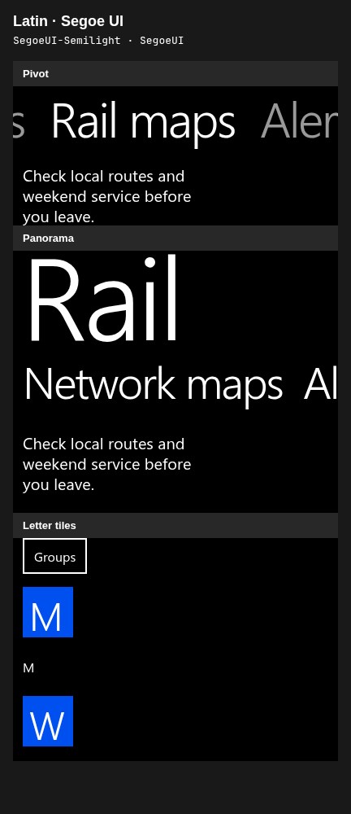
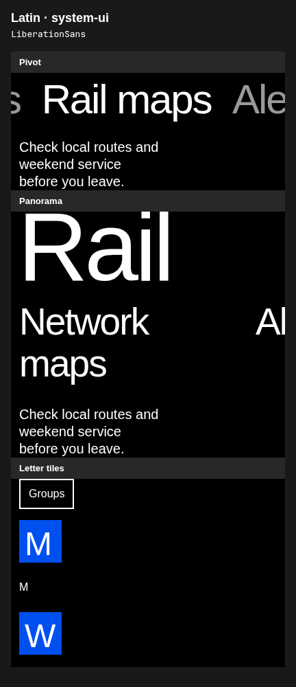
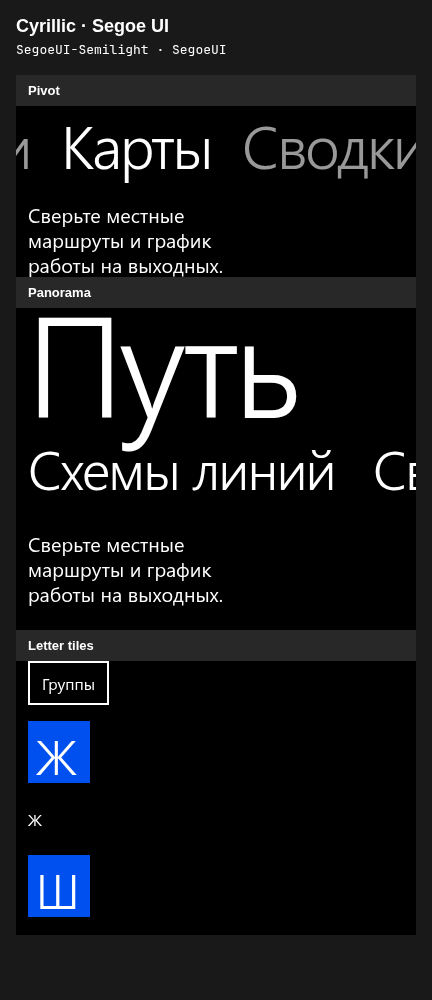
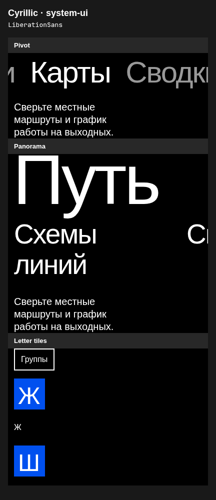

# Segoe WP and fallback fonts

This study compares Segoe WP, Segoe UI, and the font that Chromium selected for
`system-ui`. It does not change the theme or recommend a new font stack.

## Results

Segoe UI changed some widths by up to 2.64 CSS px and kept every line break in
these samples. `system-ui` selected Liberation Sans. It moved the next Pivot tab
farther out of view in both scripts. It also wrapped the active Panorama section
heading in both scripts and moved one word to the last line of the Latin body.
The letter tiles stayed on one line.

Widths below are unwrapped text widths in CSS px, including letter spacing.
They do not include padding. The comparison uses the Segoe WP column as the
reference.

### Latin

| Text | Segoe WP | Segoe UI | Liberation Sans |
| --- | ---: | ---: | ---: |
| Pivot active tab: Rail maps | 228.38 | 228.38 | 247.86 |
| Pivot next tab: Alerts | 136.23 | 133.59 | 140.78 |
| Pivot and Panorama body | 505.45 | 506.05 | 516.97 |
| Panorama title: Rail | 196.09 | 196.09 | 224.09 |
| Panorama section: Network maps | 320.02 | 320.02 | 328.39 |
| Letter tile: M | 41.53 | 41.53 | 39.98 |
| Letter tile: W | 43.91 | 43.91 | 45.31 |

- **Pivot:** The tabs do not wrap. The visible width of the next tab text falls
  from 96.44 px in Segoe WP to 96.08 px in Segoe UI and 76.92 px in Liberation Sans.
- **Panorama:** Both Segoe faces fit `Network maps` in 321 px. Liberation Sans
  breaks after `Network`. The title stays on one line.
- **Body in both components:**
  - Segoe WP and Segoe UI: `Check local routes and` / `weekend service before` / `you leave.`
  - Liberation Sans: `Check local routes and` / `weekend service` / `before you leave.`

| Segoe WP | Segoe UI | `system-ui` (Liberation Sans) |
| --- | --- | --- |
|  |  |  |

### Cyrillic

| Text | Segoe WP | Segoe UI | Liberation Sans |
| --- | ---: | ---: | ---: |
| Pivot active tab: <span lang="ru">Карты</span> | 149.94 | 150.47 | 160.48 |
| Pivot next tab: <span lang="ru">Сводки</span> | 182.17 | 182.58 | 188.77 |
| Pivot and Panorama body | 545.83 | 545.83 | 557.25 |
| Panorama title: <span lang="ru">Путь</span> | 272.50 | 271.11 | 291.38 |
| Panorama section: <span lang="ru">Схемы линий</span> | 306.58 | 306.81 | 323.28 |
| Letter tile: <span lang="ru">Ж</span> | 40.67 | 40.67 | 44.33 |
| Letter tile: <span lang="ru">Ш</span> | 43.55 | 43.55 | 44.00 |

- **Pivot:** The tabs do not wrap. The visible width of the next tab text falls
  from 174.38 px in Segoe WP to 173.91 px in Segoe UI and 164.69 px in Liberation Sans.
- **Panorama:** Both Segoe faces fit <span lang="ru">Схемы линий</span> in 321 px.
  Liberation Sans breaks after <span lang="ru">Схемы</span>. The title stays on one line.
- **Body in both components:** All three fonts use these lines:
  <span lang="ru">Сверьте местные / маршруты и график / работы на выходных.</span>

| Segoe WP | Segoe UI | `system-ui` (Liberation Sans) |
| --- | --- | --- |
|  |  |  |

## Method

- Use Chromium 159.0.8154.6 on Linux at 1 device pixel per CSS px. The captures
  use the dark color scheme and reduced motion.
- Render the same text for each font in each script. Use a 400 px component
  width, a 345 px Panorama section (321 px of text space), a 209 px body column
  in both components, and 62 × 62 px group letter tiles.
- Keep component font sizes, weights, and tracking. The Pivot tabs use 60 px,
  the Panorama title uses 141.6 px, and the Panorama section headings use 55 px,
  all at weight 300. The body uses 20 px at weight 400. The letter tiles use
  48 px at weight 350, which selects Semilight for both Segoe fonts.
- Read text widths and line positions from the browser layout. Read the rendered
  PostScript face names through Chromium DevTools. Print those names above each
  capture. Chromium reported `LiberationSans` (Regular, version 2.1.5) for every
  measured `system-ui` sample. Other systems can select a different font.

The Panorama samples are near the section width limit to show where wrapping
can change. Results apply to these strings and sizes, not to all text in either
script.

## Repeat the capture

1. Run `npm ci`, `npm run build`, and `npx playwright install chromium`.
2. Put `SegoeWP.ttf` and `SegoeWP-Semilight.ttf` in a local directory. The
   reference run used version 1.010 from the
   [PDFsharp font samples](https://github.com/empira/PDFsharp-samples-1.5/tree/e52585f33fbcadfb1ca7e64d277ce26779470504/samples/assets/fonts).
   See also the [original Windows Phone package](windows-phone-archive.md#windows-phone-7-package-contents).
3. Put the Segoe UI WOFF2 files in a second local directory. The reference run
   used Microsoft's `https://c.s-microsoft.com/static/fonts/segoe-ui/<subset>/<style>/latest.woff2`.
   Use `west-european` for `latin` and `cyrillic` for `cyrillic`. Save
   `semilight` as `<script>-300.woff2` and `normal` as `<script>-400.woff2`.
   The reference versions are 5.320 (Latin) and 5.310 (Cyrillic).
4. Run the capture script. Replace the three path arguments with your local paths.

   ```sh
   node scripts/typography-capture.mjs ./output /path/to/segoe-wp /path/to/segoe-ui
   ```

The script writes six PNG files and `measurements.json`. It rejects a missing
face, a substituted face, or different layout inputs across fonts. Keep the
font files local. This repository does not distribute them.
